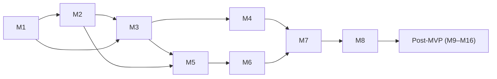

# Flakewatch Roadmap

This roadmap orders the work needed to build Flakewatch into milestones and small,
concrete tasks. The [product specification](docs/product-spec.md) defines *what* to build and the
[architecture](docs/architecture.md) defines *how*. This file only tracks *in what order*.
If the plan and those documents disagree, the documents win, and this file gets fixed.

## How to read this roadmap

- **Task IDs** look like `M3.4` (milestone 3, task 4). Tasks are units of planning, not a
  commit quota.
- **Commits** are coherent units of work. Closely related tasks go into one commit when
  that gives a cleaner history. A task is split only when it contains genuinely
  independent work. Nothing is padded, and nothing is split just to produce more commits.
- **References:** `FR-xx` is a requirement in the product specification, `§x` is a section
  of the architecture, and `UC-x` is a use case in the specification.
- **Order** follows dependencies and risk: the parts most likely to be wrong are built
  first. There are no dates; the roadmap is updated as reality changes.
- **Status:** `[ ]` not started · `[x]` done.

### Definition of done (applies to every task)

- Code ships with its tests. No task is "write the tests later". (Data-only and
  documentation-only tasks, such as fixture generation, have no tests of their own; the
  tasks that consume them do.)
- CI is green: lint, type check, unit and integration tests.
- Documentation is updated wherever behavior, configuration or the public API changes.
- No secrets or real personal data are added; new settings go into `.env.example` with
  placeholder values.
- UI changes work with the keyboard alone and at 360 px width, and never convey status by
  color alone (spec §8.2).
- The commit message follows Conventional Commits.

---

## Overview

| Milestone | Goal | Depends on | Scope |
|---|---|---|---|
| [M1](#m1--foundation-and-parsing-core) | Tooling, CI, and the parsing and identity rules, verified against real and hostile reports | — | MVP |
| [M2](#m2--server-foundation-and-ingestion) | Server skeleton, database, token-authenticated upload API | M1 | MVP |
| [M3](#m3--processing-and-flaky-detection) | Worker pipeline, flaky detection, rollups, retention | M1, M2 | MVP |
| [M4](#m4--cli-and-quarantine-gate) | The `flakewatch` CLI (`upload`, `check`) and the quarantine list API | M1–M3 | MVP |
| [M5](#m5--accounts-access-control-and-internal-api) | GitHub sign-in, sessions, authorization, internal API | M2, M3 | MVP |
| [M6](#m6--dashboard-ui) | The dashboard | M5 | MVP |
| [M7](#m7--end-to-end-quality-security-and-performance) | E2E and accessibility automation, fuzzing, benchmark, security review | M4, M6 | MVP |
| [M8](#m8--deployment-and-first-release) | Container image, self-hosting, release automation, dogfooding, v0.1.0 | M7 | MVP |
| [M9–M16](#post-mvp) | Deferred "should" items, integrations, deeper detection, sharing, notifications, scale, identity | M8 | Post-MVP |

M4 and M5 both depend only on M3 and M2, so either can go first. The CLI is scheduled first
so that real test reports flow into the system early, using a development token from
`pnpm db:seed` (M2.5), before sign-in exists.

---

## MVP

### M1 — Foundation and parsing core

**Goal:** a monorepo with complete tooling, plus the pure logic everything else depends on.
That logic turns report bytes into normalized, aggregated results, computes test
identities, and sanitizes and redacts failure text. It is verified against real reports
from seven test runners and against hostile input. No database, no server.

**Why first:** these rules decide whether every later flaky label is correct (§5), both the
CLI and the worker depend on them, and they are pure functions with fast, deterministic
tests. They are the most important part to get right and the cheapest to test. Real
reports are generated *before* the parser is written (M1.7–M1.9), so the parser is designed
against what test runners actually emit, not against assumptions.

**Creates:** root tooling, `packages/core`, `fixtures/`, `docs/reporters.md`,
`CONTRIBUTING.md`, `LICENSE`.

- [x] **M1.1 Workspace scaffold**
  - Root `package.json` (private, supported Node.js range in `engines`, pinned
    `packageManager`), `pnpm-workspace.yaml`, strict `tsconfig.base.json`.
  - `.nvmrc`, `.editorconfig`, `.gitignore`, `.gitattributes` (byte-exact `fixtures/**`).
- [x] **M1.2 License**
  - Add the MIT `LICENSE` and reference it from the README.
- [x] **M1.3 Linting and formatting**
  - ESLint flat config: typescript-eslint strict type-checked rules, plus `eslint-plugin-n`
    for `node:` imports and deprecated or engine-unsupported Node.js APIs. (Undeclared
    dependencies need no rule: pnpm's isolated layout makes them unresolvable.)
  - Prettier for code and configuration files (Markdown excluded).
  - Root `lint`, `format` and `format:check` scripts.
- [x] **M1.4 `packages/core` with test identity** — FR-30, §5.1
  - Create the package (source-consumed exports, root Vitest config with coverage, root
    `typecheck` script) together with its first real module: normalization v1 and the
    identity hash.
  - fast-check property tests: idempotence, whitespace invariance, control and bidi
    character removal.
- [ ] **M1.5 CI workflow** — spec §8.3
  - GitHub Actions: cached pnpm install, lint, type check, tests with a coverage summary.
  - Least-privilege `permissions`, actions pinned to commit SHAs, cancellation of
    superseded runs.
- [ ] **M1.6 Security automation** — spec §10.2
  - Dependabot for npm and GitHub Actions; CodeQL analysis workflow.
- [ ] **M1.7 Producer fixtures: JavaScript** — FR-27
  - Tiny sample suites, and reproducible generation in pinned Docker images of reports from
    Jest (`jest-junit`), Vitest and Playwright.
  - Cover passes, failures, errors, skips, retries, and several Playwright browser
    projects.
  - Start `docs/reporters.md` with the encodings actually observed.
- [ ] **M1.8 Producer fixtures: Python and Go** — FR-27
  - pytest (`--junitxml`, including how rerun plugins encode retries) and Go via gotestsum.
  - Extend `docs/reporters.md`.
- [ ] **M1.9 Producer fixtures: JVM** — FR-27
  - Maven Surefire (`rerunFailingTestsCount`) and Gradle (test-retry plugin).
  - Extend `docs/reporters.md`. If real output differs from the §9.3 mapping, update the
    architecture *before* the parser is written.
- [ ] **M1.10 Report input stage** — FR-28, §9.2, §14
  - Streaming gunzip with an absolute decompressed-size cap shared across a run's files.
  - UTF-8 decoding with BOM handling and replacement characters; rejection of other
    declared encodings.
  - Tests: a gzip bomb generated at test time, invalid UTF-8, UTF-16 input.
- [ ] **M1.11 XML guard** — §9.3, §14
  - Streaming transform that repairs illegal characters and illegal character references
    to U+FFFD, caps tokens at 1 MB, and rejects `<!DOCTYPE`.
  - Correct across chunk boundaries: tests split every input at every offset.
- [ ] **M1.12 JUnit parser** — FR-26, FR-28, §9.3
  - saxes-based visitor producing raw entries according to the mapping table: nested
    suites, Surefire retry elements, suite-level failures, `system-out` skipped without
    buffering, depth ≤ 32, `time` parsing, entry limit.
  - Golden tests: every producer fixture → expected raw entries.
  - Hostile samples: XXE, entity expansion, deep nesting.
- [ ] **M1.13 Attempt and duplicate aggregation** — FR-40, FR-43, §5.2
  - Streaming aggregation into one record per identity, scoped by `testsuite` element.
  - Both views: storage and the strict `check` view; counter clamping.
  - Property tests: aggregation ignores order, and ambiguous duplicates never yield retry
    evidence.
  - Golden tests on producer fixtures: retries become attempts, and Playwright browser
    projects become ambiguous duplicates.
- [ ] **M1.14 Text sanitizing and truncation** — FR-28, FR-29, §9.4
  - `sanitizeText(maxLength)`: ANSI stripping, NUL and control-character removal, line
    endings.
  - Truncation at a character boundary, with a marker.
- [ ] **M1.15 Secret redaction** — FR-29, §9.4
  - Bounded, prefix-anchored patterns: private keys (to their `END` line or the end of the
    text), authorization values, URL credentials, `key=value` secrets, and known token
    prefixes including `fwk_`.
  - A per-run time budget; text is dropped, not stored, once it is exceeded.
  - Adversarial 16 KB timing tests.
- [ ] **M1.16 Failure signatures** — FR-50, §9.4
  - Normalization of volatile parts, then a truncated SHA-256; table-driven tests.
- [ ] **M1.17 `parseRun` pipeline** — FR-25, FR-28, §9.2
  - One entry point that combines the input stage, guard, parser and aggregation for all of
    a run's files.
  - Per-file atomic discard with warnings, failure-text caps applied while streaming, and
    limit errors (`no_valid_files`, `limit_exceeded`).
  - A typed result, used later by the worker and the CLI.
  - End-to-end golden tests over all producer fixtures.
- [ ] **M1.18 Contributor guide**
  - `CONTRIBUTING.md`: prerequisites, workspace commands, test conventions, fixture
    regeneration, commit style.

**Exit criteria:**

- CI green on `main`.
- Golden tests pass for all seven producers.
- The hostile corpus is rejected within limits and time bounds.
- Property tests pass for identity and aggregation.
- `docs/reporters.md` documents each producer's retry, duplicate and suite-error encodings.

---

### M2 — Server foundation and ingestion

**Goal:** a server that durably accepts uploads from token-authenticated clients.

**Creates:** `apps/server`, `packages/contracts`, `.env.example`, `docker-compose.dev.yml`,
`docs/api.md`.

- [ ] **M2.1 `apps/server` skeleton** — spec §8.4, §15, §16
  - Fastify app factory, role dispatch in `main.ts`, environment schema validated at
    startup.
  - pino with redaction, request IDs, `AppError` → problem-details handler, `/healthz`,
    `.env.example`.
- [ ] **M2.2 `packages/contracts`** — FR-21, §7.1
  - Error codes, problem-details schema, upload metadata schema (sanitization limits;
    unknown fields ignored).
- [ ] **M2.3 Database foundation** — spec §8.1, §17
  - Drizzle and node-postgres; `docker-compose.dev.yml` with PostgreSQL.
  - The `migrate` role, and `/readyz` with a schema-version check.
  - Integration-test harness using template-database cloning; a PostgreSQL service in CI.
- [ ] **M2.4 Ingestion schema** — §6.1
  - `projects`, `api_tokens`, `runs`, `run_files`, with constraints and indexes.
  - Foreign keys to `users` follow in M5.2.
- [ ] **M2.5 API tokens and token authentication** — FR-12–14, §11.5
  - `fwk_` generation, SHA-256 storage, format pre-check, scopes, revocation, throttled
    `last_used_at`; the auth plugin.
  - `pnpm db:seed` creates a development project and token.
- [ ] **M2.6 Upload endpoint** — FR-20, FR-21, FR-23, FR-28, §9.1
  - `POST /api/v1/runs`: streaming multipart, metadata first, gzip detection, per-file
    hashing, size and file-count limits.
  - One transaction for the run and its files; `202` with the run URL.
- [ ] **M2.7 Idempotency** — FR-22, §9.1
  - Key handling, `200` replay, `409` conflict, handling of unique-violation races.
  - Integration test with concurrent identical requests.
- [ ] **M2.8 Upload protections** — §7.4, §14
  - Per-token rate limit, a semaphore on buffered uploads (`503` with `Retry-After`).
  - Early `413` from `Content-Length`, server timeouts, `ci.runUrl` validation.
- [ ] **M2.9 Public API reference**
  - `docs/api.md` for the upload endpoint: request, responses, error codes, limits.

**Exit criteria:**

- A seeded token can upload real fixture reports with `curl`.
- Runs are stored durably as `queued`.
- Integration tests cover authentication, validation, limits and idempotency races.

---

### M3 — Processing and flaky detection

**Goal:** queued runs become tests, results, flaky evidence and rollups, deterministically
and safely under concurrency.

**Creates:** the worker role, `core/detection`, `core/metrics`,
`docs/flakiness-detection.md`.

- [ ] **M3.1 Results and quarantine schema** — §6.1
  - `tests`, `results`, `failures`, `flaky_events`, `test_daily_stats`, `quarantines`,
    `scheduled_tasks`, with the indexes, fillfactor and storage settings.
- [ ] **M3.2 Worker and run claiming** — FR-24, §13.1
  - Claim query with fairness, leases and the attempt limit; fencing token; `worker_lost`
    sweep.
  - Retries with backoff; graceful shutdown that does not consume attempts.
- [ ] **M3.3 Persist pipeline** — FR-24, FR-25, FR-31, FR-40, §9.2
  - `parseRun`, then one transaction: project lock, fencing check, idempotent deletion,
    test resolution in hash order, `unnest` bulk inserts, retry events, run summary,
    timeouts.
  - Errors classified as permanent or transient.
- [ ] **M3.4 Same-commit detection function** — FR-41, FR-42, FR-44, §10
  - `detectSameCommitEvents` in `core`: independence, parallel-overlap exclusion, latest
    counterpart.
  - Property tests: invariance to upload order, no cross-variant or same-execution pairs,
    and the matrix re-run scenario.
- [ ] **M3.5 Group detection in the pipeline** — FR-41, FR-44, §10.2–10.3
  - Bounded fetch of group inputs, reconciliation of events, tracking of changed
    (day, test) pairs.
  - Integration test that processes same-commit runs concurrently.
- [ ] **M3.6 Rollup rebuild** — FR-46, FR-47, §9.5
  - Rebuild `test_daily_stats` rows for the run's day and tests, plus the changed pairs.
- [ ] **M3.7 Metrics, status and ranking** — FR-45–47, §10.4
  - Pure functions in `core` and the queries behind them: window metrics, project shares,
    the `failing` lateral lookup, deterministic ranking.
- [ ] **M3.8 Reprocessing core** — FR-92, §13.1
  - Clear a run's derived rows, recompute its group and rollups under the project lock,
    and re-queue it. The admin endpoint follows in M5.13.
- [ ] **M3.9 Maintenance tasks** — FR-90, §13.2
  - Lease-based task claiming.
  - Retention in batches, with group re-detection and rollup pruning.
  - Pruning of unseen tests that have no quarantine history.
- [ ] **M3.10 Detection documentation** — principle 1
  - `docs/flakiness-detection.md`: evidence rules, identity and variant rules, formulas,
    ranking, retroactivity, worked examples.

**Exit criteria:**

- Uploading fixture reports produces the expected tests, results, retry and same-commit
  events, and rollups.
- Concurrent and reordered processing yields identical events.
- Retention and reprocessing re-derive evidence correctly.

---

### M4 — CLI and quarantine gate

**Goal:** CI can upload results and gate on quarantine using the published CLI.

**Creates:** `packages/cli`, `docs/ci-setup.md`.

- [ ] **M4.1 `packages/cli` skeleton** — FR-73, FR-74
  - `node:util` `parseArgs`, configuration precedence with empty values treated as unset,
    exit codes.
  - A single-file tsup bundle with zero runtime dependencies; `--help`, `--version`.
- [ ] **M4.2 CI metadata detection** — FR-21, FR-70, §5.4–5.6, §8.1
  - GitHub Actions: git HEAD preferred, PR number, run and attempt, workflow/job/OS variant
    default, run URL, handling of `pull_request_target` and `workflow_run`.
  - Generic flags, with a warning when the run ID is missing; environment-fixture tests.
- [ ] **M4.3 `upload` command** — FR-70, FR-71, FR-73
  - Globs, gzip, multipart via `fetch`, an idempotency key per invocation, retries with
    jitter and `Retry-After`, total timeout, `--strict`, `--dry-run`.
  - Tested against a real server instance.
- [ ] **M4.4 Quarantine list API** — FR-61, FR-63, §7.2
  - `GET /api/v1/quarantine`: active quarantines only (expiry applied when read), requires
    `quarantine:read`.
- [ ] **M4.5 `check` command** — FR-72, §8.2
  - The full decision table: excusable exit codes, signal exits, missing, unparseable or
    stale reports, the strict failing view, suite-level failures, fail-closed fetch.
  - Exhaustive table-driven tests.
- [ ] **M4.6 Cross-platform CLI tests** — spec §8.5
  - Run the CLI test suite on Linux, macOS and Windows in CI, and on the minimum supported
    Node.js version (22) as well as the development version in `.nvmrc`.
- [ ] **M4.7 CI setup guide** — UC-1, UC-2, UC-4
  - `docs/ci-setup.md`: GitHub Actions snippet, variants for matrix builds, enabling
    retries per test runner, fork pull requests, generic CI, `check`'s residual risks.

**Exit criteria:**

- From a sample project, `upload` sends real results to a local server.
- `check` excuses only quarantined failures.
- CLI tests pass on all three operating systems.

---

### M5 — Accounts, access control and internal API

**Goal:** people can sign in, and see and manage exactly what they are authorized to.

**Creates:** mock GitHub (test support), account schema, internal API.

- [ ] **M5.1 Mock GitHub** — §17, §20
  - Fake OAuth and users API in `apps/server/test/support/`, started by `pnpm dev` and used
    by integration tests.
- [ ] **M5.2 Accounts schema** — §6.1
  - `users`, `admin_bindings`, `sessions`, `project_members`.
  - Foreign keys from `api_tokens` and `quarantines` to `users`.
  - Extend `pnpm db:seed` with a development user who owns the seeded project.
- [ ] **M5.3 GitHub sign-in** — FR-1, §11.1
  - OAuth start and callback with `state` and PKCE (verified against GitHub), a signed
    short-lived cookie, validated `next`, no scopes.
- [ ] **M5.4 Admission and admin bindings** — FR-2, FR-3, §11.1
  - Closed sign-in; config admins with permanent bindings and mismatch refusal.
  - Demotion at startup; case-insensitive logins.
- [ ] **M5.5 Sessions** — FR-6, §11.2
  - Hashed tokens, `__Host-` cookies, idle and absolute expiry, throttled `last_seen_at`,
    sign-out, pruning of expired sessions.
- [ ] **M5.6 CSRF and security headers** — §11.3, §14
  - Origin and JSON content-type checks on state-changing requests.
  - CSP, HSTS and related headers.
- [ ] **M5.7 Authorization layer** — FR-4, FR-5, §11.4
  - `Actor`, `authorizeProject`, project-scoped loaders for child objects.
  - A route-registry authorization matrix test, including child IDs from other projects.
- [ ] **M5.8 Projects API** — FR-10, FR-11, FR-80, FR-91
  - Create, list with headline numbers, settings, soft delete with name confirmation, and
    the purge maintenance task.
- [ ] **M5.9 Members and users API** — FR-3, FR-4, FR-85
  - Membership with last-owner protection.
  - Admin user management with GitHub login resolution; rules for deleting users.
- [ ] **M5.10 Token management API** — FR-12, FR-13
  - Create (secret shown once), list, revoke.
- [ ] **M5.11 Quarantine management API** — FR-60–62
  - Quarantine with reason and expiry, release, lazy closing of expired quarantines,
    history.
- [ ] **M5.12 Test read APIs** — FR-47, FR-50, FR-81–83
  - Overview, tests list (search, filters, sorting, pagination), test detail, results,
    evidence, failure signatures.
- [ ] **M5.13 Run read APIs** — FR-84, FR-92
  - Runs list with per-run flaky counts, and run detail with annotated failures and the
    overlap warning.
  - The admin reprocess endpoint.

**Exit criteria:**

- Every internal route passes the authorization matrix.
- Sign-in works end to end against the mock GitHub, including the admin-binding cases.

---

### M6 — Dashboard UI

**Goal:** every use case can be completed in the browser.

**Creates:** `apps/web`.

- [ ] **M6.1 `apps/web` skeleton** — §4.3, §19
  - Vite, React, TanStack Router and Query, Tailwind; a typed API client from `contracts`;
    a development proxy.
  - Production serving by the API server: hashed assets, SPA fallback.
- [ ] **M6.2 UI foundations** — spec §8.2
  - Theme-ready design tokens, app shell, `StatusBadge`, `DataTable`, empty, error and
    loading states, time-zone-aware time formatting.
- [ ] **M6.3 Sign-in and session handling** — FR-1, FR-2
  - Sign-in page, not-authorized page, `401` redirect with a safe `next`.
- [ ] **M6.4 Projects list and project creation** — FR-10, FR-80
- [ ] **M6.5 Project overview** — FR-47, FR-81
  - Headline numbers, an accessible trend chart, top flaky tests, recent runs.
- [ ] **M6.6 Tests list** — FR-82, FR-86
  - Search, filters, sorting and pagination, all kept in the URL.
- [ ] **M6.7 Test detail** — FR-50, FR-83
  - Status and metrics, evidence linked to runs, CI and commits, results per variant,
    failure signatures.
- [ ] **M6.8 Quarantine controls** — FR-60–62
  - Quarantine dialog (reason, expiry), release, history.
- [ ] **M6.9 Runs list and run detail** — FR-84
  - Filters, warnings, failed tests annotated as known flaky or quarantined.
- [ ] **M6.10 Project settings** — FR-11–13, FR-85, FR-87
  - General settings, members, tokens with one-time secret display, a setup snippet in
    empty states.
- [ ] **M6.11 Admin user management page** — FR-3

**Exit criteria:**

- Every use case can be completed in the browser against seeded data.
- Every page meets the definition of done for keyboard use and narrow screens.

---

### M7 — End-to-end quality, security and performance

**Goal:** confidence that the whole system works, is accessible and secure, and meets its
performance targets.

**Creates:** `e2e/`, `apps/server/bench/`, `docs/benchmarks.md`, `SECURITY.md`.

- [ ] **M7.1 E2E harness and golden path** — UC-1–UC-7
  - Playwright starts the API, worker and mock GitHub against PostgreSQL.
  - Golden path: sign in → project → token → CLI upload → flaky test visible → quarantine
    → `check` excuses it.
- [ ] **M7.2 Accessibility automation** — spec §8.2
  - axe scans of every main page, and a keyboard-only triage path.
- [ ] **M7.3 Parser fuzzing** — §14
  - fast-check-generated XML and byte mutations of producer fixtures: no crashes, and
    limits respected.
- [ ] **M7.4 Synthetic workload generator** — spec §9
  - Seeds the reference workload (3 projects × 5,000 tests × 50 runs/day × 30 days) with
    realistic flakiness patterns.
- [ ] **M7.5 Performance benchmark** — spec §9, success criterion 5
  - Measure upload acknowledgement, processing time, dashboard and quarantine endpoints,
    and memory.
  - Record results in `docs/benchmarks.md`; fix regressions or document deviations.
- [ ] **M7.6 Security review** — spec §10
  - Walk the threat model and architecture §14 against the implementation; audit
    dependencies; fix findings.
  - Add `SECURITY.md` (private reporting through GitHub Security Advisories).

**Exit criteria:**

- E2E and accessibility suites are green in CI.
- The benchmark meets spec §9, or deviations are documented.
- Security findings are resolved, or tracked as issues with a rationale.

---

### M8 — Deployment and first release

**Goal:** anyone can self-host Flakewatch, and Flakewatch tracks its own CI. This milestone
completes the MVP.

**Creates:** `Dockerfile`, `docker-compose.yml`, `docs/self-hosting.md`, `release.yml`,
`CHANGELOG.md`.

- [ ] **M8.1 Container image** — §19
  - Multi-stage `Dockerfile` (non-root, health check, roles `api`, `worker`, `migrate`),
    `.dockerignore`, image build in CI.
- [ ] **M8.2 Reference deployment** — §19
  - `docker-compose.yml`: PostgreSQL, migrate, api, worker; the API port exposed only to
    the proxy; `FLAKEWATCH_TRUST_PROXY`; `stop_grace_period`.
  - Complete `.env.example`.
- [ ] **M8.3 Self-hosting guide** — spec §8.4
  - `docs/self-hosting.md`: requirements, the GitHub OAuth app, configuration reference,
    TLS with Caddy, upgrades, backup and a restore check.
- [ ] **M8.4 Release automation** — spec §10.2
  - A tag-triggered workflow that publishes the image to GHCR and the CLI to npm with
    provenance.
  - `CHANGELOG.md`; confirm the npm package name.
- [ ] **M8.5 README**
  - Overview, features, screenshots, architecture summary, quick start, configuration,
    testing, deployment, roadmap, license.
- [ ] **M8.6 Dogfooding** — success criterion 1
  - Run an instance, and make Flakewatch's own CI upload its results and use `check`.
  - Where to host it is the owner's decision.
- [ ] **M8.7 Release v0.1.0** — spec §11
  - Verify the success criteria, including the 15-minute quick start from a fresh clone.
  - Tag and publish.

**Exit criteria:** every success criterion in spec §11 is met, and v0.1.0 is published.

---

## Post-MVP

These milestones are ordered by expected value, but their order is not fixed. Feedback
from the dogfooding instance and from early users decides it. Each item becomes a GitHub
issue when its milestone is scheduled and is then broken into small, concrete tasks like
those above.

### M9 — Deferred "should" items

- [ ] ETag and `304` on the quarantine list, computed over `tests` only (FR-64)
- [ ] Release candidates: at least 10 runs and no failures since quarantine (FR-65)
- [ ] New-test warning, with deterministic first-seen tracking (FR-32)
- [ ] GitHub Action wrapping `upload` and `check` (FR-75)
- [ ] Audit log for token, membership and user changes (spec §10.2)
- [ ] Admin system page: queue depth, failed runs, maintenance-task status (§16)
- [ ] Dark theme (spec §8.2)
- [ ] `linux/arm64` image (spec §8.4)

### M10 — GitHub integration

- [ ] GitHub App: a pull request comment classifying failures as known flaky,
      quarantined or new
- [ ] Checks API annotations on failing tests
- [ ] Opt-in automatic issues for newly flaky tests, linked to their evidence
- [ ] GitHub job summary written by the CLI
- [ ] `upload --wait`, printing flaky annotations once processing finishes
- [ ] Tokenless uploads with GitHub Actions OIDC
- [ ] A safe upload pattern for fork pull requests (`workflow_run`)

### M11 — More CI systems and reporters

- [ ] Metadata detection for GitLab CI, CircleCI and Buildkite
- [ ] Native reporters for Vitest/Jest, pytest and Playwright that capture retries and
      environment explicitly
- [ ] `check` wrapper mode (`check -- <command>`) with report freshness checked against the
      command's start time (ADR-13)

### M12 — Detection and insights

- [ ] Detection of tests that got slower (change-point detection on durations)
- [ ] Heuristic cross-commit signals (flip rate on the default branch), clearly labeled as
      heuristics (ADR-6)
- [ ] Grouping of parameterized tests
- [ ] Test rename tracking that carries history and quarantines across a rename
- [ ] Clustering failures across tests by signature, to reveal shared root causes
- [ ] Flakiness onset: the commit range in which a test became flaky
- [ ] An estimate of CI minutes spent on re-runs

### M13 — Sharing and public projects

- [ ] Public, read-only projects for open-source repositories
- [ ] SVG status badges (flake rate, flaky test count)
- [ ] Public read API with read-scoped tokens, and a published OpenAPI document
- [ ] CSV and JSON export of tests and evidence

### M14 — Notifications

- [ ] A general job queue (pg-boss or a jobs table; ADR-2)
- [ ] Generic webhooks and Slack notifications for new flaky tests and expiring
      quarantines
- [ ] Weekly email digests over SMTP

### M15 — Scale and operations

- [ ] Opt-in Prometheus metrics and OpenTelemetry tracing
- [ ] Incremental rollups and per-(commit, variant) locking (ADR-4, ADR-5)
- [ ] Time-partitioned `results`, and long-term aggregates beyond the retention period
- [ ] Object storage for raw uploads (ADR-3)
- [ ] Several API instances, with shared rate limits (ADR-11)
- [ ] Zero-downtime (expand/contract) migrations
- [ ] A Helm chart
- [ ] `pg_trgm` index for test search

### M16 — Access and identity

- [ ] Generic OIDC / SSO sign-in
- [ ] Email and password accounts
- [ ] Admission based on GitHub organization or team membership

### Not planned

These are permanent non-goals (spec §6): running tests or orchestrating CI re-runs, test
case management, coverage or log storage, a multi-tenant hosted SaaS, and
machine-learning-based classification.

---

## Appendix: requirement coverage

Every *must* requirement maps to at least one MVP task.

| Requirements | Tasks |
|---|---|
| FR-1–6 (accounts and access) | M5.3–M5.7, M5.9, M6.3, M6.11 |
| FR-10–14 (projects and tokens) | M2.5, M5.8, M5.10, M6.4, M6.10 |
| FR-20–29 (ingestion) | M1.7–M1.17, M2.2, M2.6–M2.8 |
| FR-30–31 (identity) | M1.4, M3.3 |
| FR-40–47 (detection and metrics) | M1.13, M3.3–M3.7 |
| FR-50 (failure signatures) | M1.16, M5.12, M6.7 |
| FR-60–63 (quarantine) | M3.1, M4.4, M5.11, M6.8 |
| FR-70–74 (CLI) | M4.1–M4.6 |
| FR-80–87 (dashboard) | M5.8, M5.12, M5.13, M6.4–M6.10 |
| FR-90–92 (data lifecycle) | M3.8, M3.9, M5.8, M5.13 |
| Spec §8 (non-functional) | M1.3–M1.6, M2.1, M3.2, M4.6, M7.1–M7.2, M8.1–M8.3 |
| Spec §9 (performance) | M7.4, M7.5 |
| Spec §10 (security) | M1.6, M1.10–M1.15, M2.5, M2.8, M5.3–M5.7, M7.3, M7.6 |
| *Should* items | FR-50 and FR-92 in the MVP; FR-32, FR-64, FR-65, FR-75 in M9 |
