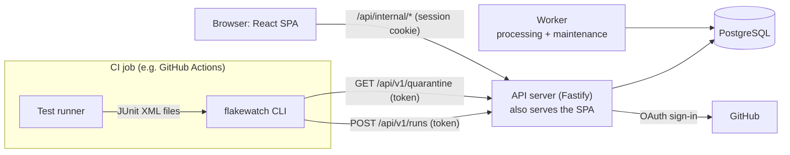
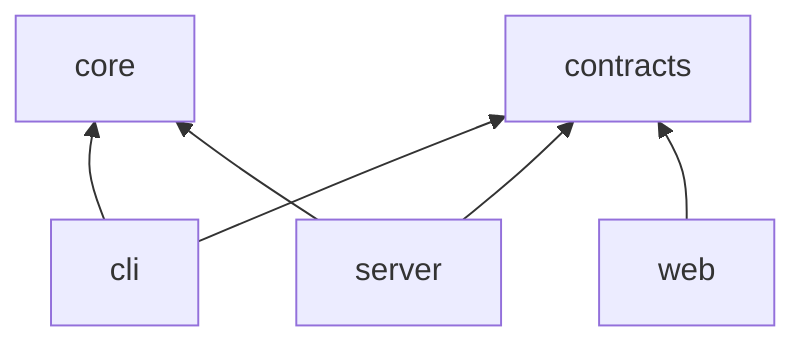
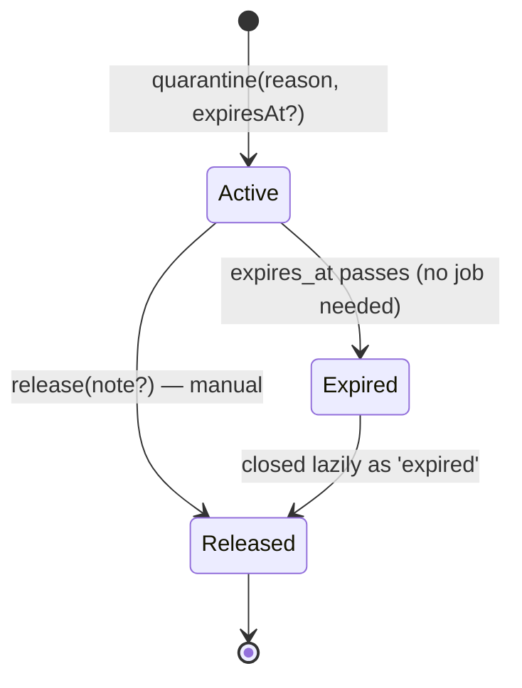
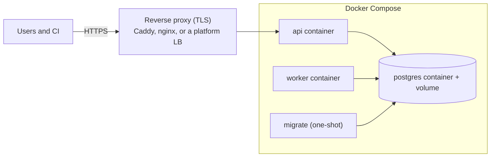

# Flakewatch — Architecture

| | |
|---|---|
| **Status** | Draft v0.3 |
| **Last updated** | 2026-10-19 |
| **Implements** | [Product specification](product-spec.md) v0.2 |
| **Related** | [Repository structure](repository-structure.md), [Roadmap](../ROADMAP.md) |

This document describes how Flakewatch is built: its components, data model, APIs,
algorithms and operational design, and the reasoning behind each choice. Requirements are
referenced by their IDs in the product specification (for example FR-41).

**Scope markers.** Everything here is part of the MVP unless marked **[Later]**. Items
the specification rates *should* are marked **(S)**. Section 22 lists the MVP boundary
in one place.

---

## 1. Architectural drivers

| Driver (spec reference) | Consequence for the architecture |
|---|---|
| Evidence over guesswork (principle 1, FR-40–46) | Detection is a pure, deterministic function over stored results. Every flaky event references the run that shows the failure and, for same-commit evidence, a run that shows the pass. Where results *might* come from different environments, no evidence is produced. |
| Never become a new source of CI flakiness (principle 2, FR-71, FR-72) | Uploads are acknowledged quickly and processed asynchronously (FR-23). The CLI treats upload problems as warnings. `check` runs only after tests have already failed, and fails closed. |
| Your data stays yours (principle 3) | One application image plus PostgreSQL. The only outbound dependency is GitHub, for sign-in. No telemetry. |
| Low adoption cost (principle 4) | Standard JUnit XML, zero-configuration metadata on GitHub Actions, and a dependency-free CLI run with `npx`. |
| Performance targets (§9) | A streaming parser, bulk inserts, a daily rollup table for dashboard queries, and a worker process separate from the API. |
| Hostile input (§10) | An input guard in front of the XML parser, hard caps on every dimension, and text-only rendering of anything that came from a report. |

---

## 2. System overview



| Component | Responsibility | Process |
|---|---|---|
| **CLI** (`flakewatch` on npm) | Collects report files and CI metadata and uploads them. After a failed test command, decides whether every failure is quarantined (`check`). | Runs inside the CI job |
| **API server** | Public token-authenticated API (uploads, quarantine list); internal session-authenticated API for the dashboard; GitHub sign-in; serves the built SPA. | `node server.js api` |
| **Worker** | Parses uploads, stores results, detects flakiness, maintains rollups; runs maintenance (retention, project purge). | `node server.js worker` |
| **PostgreSQL** | All durable state: users, projects, runs, raw uploads, results, events, rollups, and the processing queue itself. | External dependency |
| **Web SPA** | The dashboard. Static files built by Vite and served by the API server from the same origin. | Browser |

API and worker are **one image and codebase with two entry points**. They are separate
processes because XML parsing is CPU-bound and must not block the event loop that serves
HTTP requests.

### 2.1 Main flows

1. **Upload.** The CLI sends one multipart request per run. The API authenticates the token,
   validates metadata, enforces size limits while streaming, and stores the run row and raw
   files in one transaction. Then it returns `202` with the run URL (FR-20–23; §9.1).
2. **Processing.** A worker claims a queued run and parses its files outside any
   transaction. Then, in one transaction serialized per project, it stores tests and
   results, recomputes flaky evidence for the run's commit group, and refreshes the
   affected rollup rows (§9.2, §10).
3. **Dashboard.** The SPA calls the internal API. Lists and the overview read the rollup
   table plus the window's runs; detail views read raw rows for one test or run (§18).
4. **Gating.** Only when the test command fails does CI call `flakewatch check` with its
   exit code. `check` parses the local reports, fetches the quarantine list, and exits 0
   only when every failure is quarantined and nothing looks like a crash (§8.2).

---

## 3. Technology choices

| Concern | Choice | Reasoning | Rejected |
|---|---|---|---|
| Language | TypeScript, `strict` everywhere | One language for CLI, server and UI. The parser and test-identity logic are shared between the CLI and the server (FR-30). | Python backend: two languages, and no shared parser for the CLI. |
| Runtime | Node.js 22+ (LTS lines) | Built-in `fetch`, `FormData`, streams, zlib and crypto. The CLI needs no native dependencies (FR-74). | — |
| HTTP server | Fastify | Schema-driven validation, streaming multipart with limits, `inject()` for fast integration tests, built-in pino logging. | Express (weaker validation and typing); Next.js (see ADR-1). |
| Frontend | React SPA built with Vite; TanStack Router and TanStack Query; Tailwind CSS; Radix UI primitives | The dashboard sits behind a login, so server-side rendering adds little. TanStack Router gives typed, validated URL search params (FR-86). Radix provides accessible primitives (spec §8.2). | Next.js (ADR-1). |
| Database | PostgreSQL 16+ | Relational data with strong constraints, transactional queueing via `SKIP LOCKED`, advisory locks, and mature tooling. | — |
| Database access | Drizzle ORM on node-postgres. Migrations generated by drizzle-kit as SQL files, reviewed and committed. | Typed queries, plus a raw-SQL escape hatch for bulk `unnest` inserts, advisory locks and aggregates. | Prisma (weak bulk and raw-SQL story); Kysely (equally viable — Drizzle chosen for schema-as-code and generated migrations). |
| API contracts | Zod schemas in a shared package | One definition for request validation (server), typed clients (SPA and CLI) and error codes. | — |
| XML parsing | `saxes` (streaming, strict) behind our own **XML guard** transform (§9.3) | Constant memory and no entity-expansion surface. The guard repairs illegal characters and caps token sizes, which a strict parser cannot do itself. | `fast-xml-parser` (builds a whole-document object); `libxmljs` (native dependency, DTD features). |
| Sign-in | A small OAuth client (arctic) plus our own session handling | Little code that is easy to audit, and closed sign-in is easy to express (FR-2). The GitHub flow is only two HTTP calls, so a hand-written client is an acceptable fallback. | Auth.js / better-auth (tables and abstractions for features we don't need). |
| Background work | The `runs` table is the queue (`SKIP LOCKED`, leases, fencing); maintenance tasks are claimed through lease rows | No extra infrastructure, enqueueing is transactional with the upload, and the run's status *is* the job status (FR-24). | pg-boss; BullMQ with Redis (ADR-2). |
| Logging | pino (structured JSON) | Fastify's native logger: fast, with built-in redaction paths. | — |
| Testing | Vitest, fast-check, Playwright, axe-core | §17. | Jest (slower with TypeScript and ESM, no benefit here). |
| Monorepo | pnpm workspaces. Internal packages are consumed as TypeScript source. tsup bundles the server and CLI; Vite builds the SPA. | Enough structure for five workspace packages without a build orchestrator. | Turborepo / Nx (unnecessary at this size; can be added later). |

**Deliberately absent:** Redis, a message broker, object storage, a cache layer, and a
search engine. The reference workload (spec §9) justifies none of them. Section 18.3
describes when each would become worth adding.

---

## 4. Repository and package structure

```text
flakewatch/
├── apps/
│   ├── server/             # API + worker + migrations — one deployable image
│   └── web/                # React SPA (static build, served by the server)
├── packages/
│   ├── core/               # Pure domain logic: report input stage, XML guard and JUnit
│   │                       # parser, identity, attempt aggregation, detection, status,
│   │                       # text sanitizing/redaction, failure signatures
│   ├── contracts/          # Zod schemas, API types, error codes
│   └── cli/                # The `flakewatch` npm package (upload, check)
├── e2e/                    # Playwright end-to-end and accessibility tests
├── fixtures/
│   ├── producers/          # Real reports from Jest, Vitest, pytest, Go, Surefire, Gradle, Playwright
│   └── hostile/            # Small hostile samples; large ones are generated at test time
├── docs/
├── docker-compose.yml      # Self-hosting reference deployment
├── docker-compose.dev.yml  # PostgreSQL for development and tests
└── .github/workflows/
```

The complete layout, root files, per-package rules and conventions are defined in
[repository-structure.md](repository-structure.md).

### 4.1 Dependency rules



- `core` and `contracts` have no internal dependencies. `core` does no I/O of its own:
  callers hand it byte streams, and it returns plain data.
- Inside `core`, the parser modules (`input/`, `junit/`) emit raw test-case records, and
  the domain modules normalize and aggregate them. This is a folder boundary rather than
  a package boundary: the parser has no other consumers, and one package is simpler to
  maintain (ADR-12).
- `web` depends only on `contracts`, so parser code and Node.js built-ins never reach the
  browser bundle.
- Allowed imports are exactly the `package.json` dependencies. pnpm's isolated
  `node_modules` layout enforces this: an undeclared package cannot be resolved, so type
  checking fails. Only the root's tooling dependencies are visible to every package.
- Internal packages export TypeScript source (`"exports": "./src/index.ts"`), so there is
  no per-package build step. The server and CLI are bundled with tsup, inlining
  `@flakewatch/*` and third-party dependencies. The published CLI therefore has zero
  runtime dependencies (FR-74).

### 4.2 Server layering

```text
apps/server/src/
├── main.ts            # entry: `api` | `worker` | `migrate`
├── config/            # environment schema (zod), validated at startup (spec §8.4)
├── http/
│   ├── app.ts         # Fastify factory (used by tests and main)
│   ├── plugins/       # auth (session/token), errors, security headers, rate limits
│   └── routes/
│       ├── public/    # /api/v1/* — token auth
│       ├── internal/  # /api/internal/* — session auth
│       └── auth/      # GitHub OAuth
├── services/          # business logic + authorization (one place, §11.4)
├── ingest/            # multipart handling, limits, payload hashing
├── processing/        # parse → persist → detect → rollup (worker pipeline)
├── jobs/              # run claiming loop, maintenance tasks
├── db/
│   ├── schema.ts      # Drizzle schema
│   ├── migrations/    # generated SQL, reviewed and committed
│   └── queries/       # query functions grouped by aggregate (no generic repository layer)
└── lib/               # clock, crypto, logger, locks
```

Routes are thin: parse input, call one service method, map the result. Services take an
explicit `Actor` (a user or a token) and perform the authorization check before any data
access. Database access lives in `db/queries`. Time comes from an injected `Clock`, so
tests are deterministic.

### 4.3 Frontend architecture

```text
apps/web/src/
├── routes/            # TanStack Router file routes; search params validated with zod
├── features/          # tests/, runs/, overview/, quarantine/, settings/, admin/
│                      #   components + query hooks per feature
├── components/        # shared UI: DataTable, StatusBadge, EmptyState, ErrorState, TimeAgo …
└── lib/               # typed API client (contracts), formatting, time zones
```

| Route | Page | FR |
|---|---|---|
| `/sign-in` | Sign in with GitHub (a plain link, not a form) | FR-1 |
| `/` | Projects list | FR-80 |
| `/p/:slug` | Project overview | FR-81 |
| `/p/:slug/tests`, `/p/:slug/tests/:testId` | Tests list, test detail | FR-82, FR-83 |
| `/p/:slug/runs`, `/p/:slug/runs/:runId` | Runs list, run detail | FR-84 |
| `/p/:slug/settings/{general,members,tokens}` | Project settings | FR-85 |
| `/admin/users` | User management | FR-3 |

- **Server state** lives in TanStack Query. There is no global client store. Filters,
  sorting and pagination live in the URL (FR-86).
- **Status display** uses one `StatusBadge` component with icon, text and color, so status
  is never conveyed by color alone (spec §8.2). Color tokens are defined for both themes
  from the start, even though the dark theme (S) may ship after the MVP.
- **Untrusted text** (test names, messages, branches) is rendered only as React text
  nodes. `dangerouslySetInnerHTML` is banned by lint rule (§14).
- **Session expiry:** any `401` sends the user to `/sign-in?next=<path>`. The `next` value
  is validated as a same-origin relative path (§11.1).
- **Development:** the Vite dev server proxies `/api` and `/auth` to the local API server.
  In production both are served from one origin, so there is no CORS configuration.

---

## 5. Identity rules: tests, attempts, runs, executions, variants, commits

These rules decide which results can be compared. Most false flaky labels would come from
getting them wrong, so they are stated precisely, implemented once in `core`, and covered
by property-based tests (§17). **The guiding rule: when results *might* come from
different environments, they are not used as evidence.**

### 5.1 Test identity (FR-30, FR-31)

- **Source fields.** `suite` is `testcase@classname`; if absent, the name of the nearest
  enclosing `testsuite`; if that is absent too, the empty string. `name` is
  `testcase@name`. Entries skipped with a warning:
  - a name that is empty after normalization;
  - a normalized suite or name longer than 4,096 code points. Identities are never
    computed from truncated strings.
- **Normalization (version 1)**, applied in this order:
  1. Replace unpaired UTF-16 surrogates with U+FFFD.
  2. Remove three groups of characters:
     - control characters (Unicode category Cc) that are not whitespace;
     - the bidirectional formatting characters U+061C, U+200E, U+200F, U+202A–U+202E and
       U+2066–U+2069;
     - the invisible characters U+200B (zero width space), U+2060 (word joiner) and
       U+FEFF (zero width no-break space, also used as a byte-order mark). Names that look
       identical therefore never differ only because one contains an accidental invisible
       character.
  3. Replace each run of whitespace (Unicode White_Space, which includes tab, line breaks
     and no-break space) with one space, and trim spaces at both ends.
  4. Apply Unicode NFC. This runs last, because step 2 can bring a base character and a
     combining mark together.

  Case and all other characters are preserved. That includes U+200D (zero width joiner),
  which is part of emoji sequences, and U+200C (zero width non-joiner), which is
  meaningful in some writing systems.
- **Identity hash** = SHA-256 over the UTF-8 encoding of `"v1\0" + suite + "\0" + name`,
  as lowercase hexadecimal. Normalized names never contain NUL, so the encoding is
  unambiguous. The CLI and server call the same function, so `check` matches the server's
  quarantine list exactly.
- **Display values** are stored truncated to 500 characters. The hash is always computed
  from the full normalized value, which is discarded after hashing (§9.2, memory).
- **File path** (`testcase@file`, otherwise `testsuite@file`) is display-only: backslashes
  become `/`, a leading `./` is removed, and it is truncated to 500 characters.
- **Changing normalization** creates a new version and needs a data migration that rehashes
  existing tests. It is treated as a breaking change.
- Each parameterized test case is its own test. A renamed test is a new test.
  **[Later]** grouping of parameterized tests and rename tracking.

### 5.2 Attempts and duplicates within one run (FR-26, FR-40, FR-43)

A run can report the same identity more than once. What a repetition means depends on
where it occurs:

| Where the repetition occurs | Meaning | Retry evidence |
|---|---|---|
| Explicit retry elements: Surefire `flakyFailure`/`flakyError` (inside a passing testcase), `rerunFailure`/`rerunError` (inside a failing testcase) | Attempts of one execution | Yes |
| Repeated `<testcase>` entries inside the **same** `<testsuite>` element (e.g. Gradle's test-retry plugin) | Attempts of one execution | Yes |
| Entries in **different** `<testsuite>` elements or different files | **Ambiguous duplicate**: often the same test run in several environments, e.g. Playwright browser projects without `includeProjectInTestName` | **No** |

**Aggregation for storage**, which does not depend on order:

```text
passed = attempts that passed;  failed = attempts that failed or errored

if ambiguous duplicate:
    outcome = failed  if any copy has <failure>
            = errored if any copy has <error>
            = passed  if any copy passed
            = skipped otherwise
    no retry evidence; counted in runs.ambiguous_duplicates; warning on the run
else:
    outcome = passed  if passed > 0
            = failed  if any attempt has <failure>
            = errored if any attempt has <error>
            = skipped otherwise
    retry evidence (FR-40) ⇔ passed > 0 and failed > 0

duration = sum of attempt durations, clamped to the integer range
```

Within one entry, precedence is failure > error > skipped > passed. How each producer
actually encodes retries is pinned by fixture tests (FR-27). Any additional explicit
retry encodings found there (for example a pytest plugin's elements) are added to the
first row of the table.

**Strict view for `check`.** `check` treats a test as failing if *any* of its attempts
failed, unless every failed attempt is an explicit Surefire `flaky*` element, which by
definition passed on retry. This only matters once the test command has already failed,
so the strictness costs nothing. It stops a failure in one environment from being hidden
by a pass in another.

### 5.3 Run identity

One upload is one run. Within a project, a run is identified by its idempotency key
(§9.1). One run should contain results from exactly one environment. The rules in §5.2
and §5.4 limit the damage when it doesn't.

### 5.4 CI execution identity (FR-42)

- **CI run** = (`ci.provider`, `ci.runId`). **Execution key** = (`ci.provider`, `ci.runId`,
  `ci.attempt ?? 1`). Both are null when no run ID is reported.
- Runs with the same execution key ran **in parallel**: matrix legs, shards, or separate
  jobs of one attempt. They are never counterparts for each other.
- On GitHub, "re-run failed jobs" keeps `GITHUB_RUN_ID` and increments
  `GITHUB_RUN_ATTEMPT`. That is a different execution, so it is a valid counterpart, and
  it is the most important source of same-commit evidence.
- **Parallel-overlap exclusion.** If, within a commit group, a test is reported by two or
  more runs that share an execution key, its results may come from different
  environments (for example a matrix whose legs share a variant). That test is then
  excluded from same-commit comparisons for *every* run of that CI run, across all
  attempts. Without this rule, re-running a failed Windows leg would compare the Windows
  failure with the Ubuntu pass from attempt 1. Shards are unaffected, because shards
  don't share tests. Run detail shows the overlap as a warning, computed at query time.
- Runs with a null execution key are treated as independent. On generic CI the CLI warns
  when `--run-id` is missing (§8.1). The setup guide explains why it matters.

### 5.5 Variant (FR-21, FR-42)

- A free-text label of 1–200 characters, normalized like test names. An empty value means
  unset. The server default is `default`.
- On GitHub Actions the CLI defaults to
  `<GITHUB_WORKFLOW>/<GITHUB_JOB>/<RUNNER_OS>-<RUNNER_ARCH>`, e.g. `CI/test/Linux-X64`.
  This separates workflows that use the same job ID, and separates OS legs of a matrix
  automatically. Matrix dimensions that don't change the OS (a Node version, a database
  version) need `--variant`. If that is omitted, the parallel-overlap exclusion (§5.4)
  prevents false evidence.
- Changing a variant label splits the history. This is by design.

### 5.6 Code identity

- `commitSha`: a full 40- or 64-character hexadecimal SHA, lowercased. Required (FR-21).
- **On GitHub Actions the CLI prefers `git rev-parse HEAD`** in the working directory
  (the code actually checked out) and falls back to `GITHUB_SHA`. If the two differ, it
  warns. For `pull_request_target` and `workflow_run` events, `GITHUB_SHA` is not the
  tested code, so when no git HEAD is available the upload is skipped with a warning.
- For `pull_request` events, the checkout is the temporary merge commit. That is the code
  under test, so re-runs share it, and a new merge commit after the base branch moves is
  different code. The PR number is stored for linking.
- `branch`: `GITHUB_HEAD_REF` for pull requests, `GITHUB_REF_NAME` for branch pushes, and
  null for tags.
- **Default-branch run** (FR-45): `pull_request is null and branch =
  projects.default_branch`. A fork pull request whose branch happens to be named `main` is
  not a default-branch run.

### 5.7 Time

- The server's receipt time (`received_at`) is authoritative for analysis windows,
  retention and ordering. Derived values such as `first_seen_at`, `last_seen_at` and
  `last_flaky_at` are computed from `received_at` with `least`/`greatest`, so they don't
  depend on processing order. The client-supplied `startedAt` is only displayed.
- Days are UTC calendar days. An analysis window of N days is today (UTC) plus the
  previous N−1 days.

---

## 6. Data model

Conventions: every primary key is `bigint generated always as identity` (ADR-7);
timestamps are `timestamptz` in UTC; API JSON serializes IDs as strings. Enumerations
are `text` with `CHECK` constraints for readability, except in the high-volume
`results` table, which uses `smallint` codes defined in `core`.

### 6.1 Schema

```sql
-- Accounts --------------------------------------------------------------------
create table users (
  id             bigint generated always as identity primary key,
  github_id      bigint not null unique,           -- stable; logins can change
  github_login   text   not null,                  -- refreshed at each sign-in
  display_name   text,
  avatar_url     text,
  role           text   not null check (role in ('admin', 'user')),
  admin_source   text   check (admin_source in ('config', 'granted')),
  created_at     timestamptz not null default now(),
  last_login_at  timestamptz,
  check ((role = 'admin') = (admin_source is not null))
);

-- Permanent binding of FLAKEWATCH_ADMINS entries to GitHub accounts (§11.1).
create table admin_bindings (
  login      text   primary key,                   -- lowercased configuration entry
  github_id  bigint not null,
  bound_at   timestamptz not null default now()
);

create table sessions (
  token_hash     bytea  primary key,               -- SHA-256 of the cookie value
  user_id        bigint not null references users on delete cascade,
  created_at     timestamptz not null default now(),
  last_seen_at   timestamptz not null default now(),
  expires_at     timestamptz not null              -- absolute lifetime
);
create index sessions_user_idx    on sessions (user_id);
create index sessions_expires_idx on sessions (expires_at);

-- Projects --------------------------------------------------------------------
create table projects (
  id                    bigint generated always as identity primary key,
  slug                  text not null check (slug ~ '^[a-z0-9][a-z0-9-]{0,62}$'),
  name                  text not null check (length(name) between 1 and 100),
  default_branch        text not null default 'main',
  analysis_window_days  smallint not null default 14 check (analysis_window_days between 1 and 90),
  retention_days        smallint not null default 30 check (retention_days between 7 and 365),
  created_at            timestamptz not null default now(),
  updated_at            timestamptz not null default now(),
  deleted_at            timestamptz,                      -- soft delete, purged by maintenance
  check (retention_days >= analysis_window_days)
);
create unique index projects_slug_live_idx on projects (slug) where deleted_at is null;

create table project_members (
  project_id  bigint not null references projects on delete cascade,
  user_id     bigint not null references users    on delete cascade,
  role        text   not null check (role in ('owner', 'member')),
  created_at  timestamptz not null default now(),
  primary key (project_id, user_id)
);
create index project_members_user_idx on project_members (user_id);

create table api_tokens (
  id            bigint generated always as identity primary key,
  project_id    bigint not null references projects on delete cascade,
  name          text   not null check (length(name) between 1 and 100),
  token_hash    bytea  not null unique,             -- SHA-256 of the full token
  token_hint    text   not null,                    -- last 4 characters, for display
  scopes        text[] not null check (cardinality(scopes) > 0
                  and scopes <@ array['results:write', 'quarantine:read']),
  created_by    bigint references users on delete set null,
  created_at    timestamptz not null default now(),
  last_used_at  timestamptz,
  revoked_at    timestamptz
);
create index api_tokens_project_idx on api_tokens (project_id);

-- Runs and raw uploads ----------------------------------------------------------
create table runs (
  id                     bigint generated always as identity primary key,
  project_id             bigint not null references projects on delete cascade,
  idempotency_key        text   not null,           -- client-supplied, or server-generated
  payload_sha256         bytea  not null,
  status                 text   not null check (status in ('queued', 'processing', 'completed', 'failed')),
  commit_sha             text   not null check (commit_sha ~ '^([0-9a-f]{40}|[0-9a-f]{64})$'),
  branch                 text,
  pull_request           integer,
  ci_provider            text   not null,           -- 'github_actions' | 'generic'
  ci_run_id              text,
  ci_attempt             integer,                   -- treated as 1 when null and ci_run_id is set
  job_name               text,
  variant                text   not null,
  ci_run_url             text,                      -- validated http(s) only
  started_at             timestamptz,               -- client-reported, display only
  received_at            timestamptz not null default now(),
  -- processing state: the run row is the queue entry (§13)
  processing_attempts    smallint not null default 0,  -- also the fencing token
  next_attempt_at        timestamptz not null default now(),
  locked_until           timestamptz,
  processed_at           timestamptz,
  processing_ms          integer,
  error_code             text,
  error_message          text,
  warnings               jsonb not null default '[]',
  -- summary of this run's own results, filled in on completion
  total_count            integer, passed_count integer, failed_count integer,
  errored_count          integer, skipped_count integer,
  ambiguous_duplicates   integer, unattributed_failures integer,
  unique (project_id, idempotency_key)
);
create index runs_project_received_idx on runs (project_id, received_at desc, id desc);
create index runs_commit_group_idx     on runs (project_id, commit_sha, variant);
create index runs_inflight_idx         on runs (project_id, id) where status in ('queued', 'processing');

create table run_files (
  run_id            bigint   not null references runs on delete cascade,
  ordinal           smallint not null,
  filename          text     not null,              -- display only, never a filesystem path
  content_gz        bytea    not null,              -- always gzip
  compressed_bytes  integer  not null,
  sha256            bytea    not null,              -- of the bytes as uploaded
  primary key (run_id, ordinal)
);
-- Content is already compressed: store it out of line without TOAST compression.
alter table run_files alter column content_gz set storage external;

-- Tests and results -------------------------------------------------------------
create table tests (
  id             bigint generated always as identity primary key,
  project_id     bigint not null references projects on delete cascade,
  identity_hash  bytea  not null,
  suite          text   not null,                   -- display, ≤ 500 chars
  name           text   not null,                   -- display, ≤ 500 chars
  file           text,
  first_seen_at  timestamptz not null,              -- least(received_at)
  last_seen_at   timestamptz not null,              -- greatest(received_at), updated ≤ 1×/hour
  unique (project_id, identity_hash)
) with (fillfactor = 80);   -- last_seen_at updates touch no index → HOT updates

create table results (
  run_id           bigint   not null references runs  on delete cascade,
  test_id          bigint   not null references tests on delete cascade,
  outcome          smallint not null,               -- 1 passed, 2 failed, 3 errored, 4 skipped
  attempts         smallint not null,               -- clamped to 32767
  failed_attempts  smallint not null,               -- clamped to 32767
  duration_ms      integer,                         -- clamped
  primary key (run_id, test_id)
);
create index results_test_idx on results (test_id, run_id desc) include (outcome);

create table failures (
  run_id          bigint   not null,
  test_id         bigint   not null,
  attempt         smallint not null,                -- 0..2: at most 3 failed attempts stored per result
  kind            smallint not null,                -- 1 failure, 2 error
  type            text,                             -- exception type, ≤ 200 chars
  message         text     not null,                -- sanitized, truncated, redacted
  signature_hash  bytea    not null,                -- FR-50
  primary key (run_id, test_id, attempt),
  foreign key (run_id, test_id) references results on delete cascade
);
create index failures_test_idx on failures (test_id, run_id desc);

create table flaky_events (
  run_id              bigint   not null,            -- the run in which the test failed
  test_id             bigint   not null,
  kind                smallint not null,            -- 1 retry, 2 same_commit
  counterpart_run_id  bigint references runs on delete set null,  -- latest passing run (same_commit)
  detected_at         timestamptz not null default now(),
  primary key (run_id, test_id),                    -- one event per affected (run, test)
  foreign key (run_id, test_id) references results on delete cascade
);
create index flaky_events_test_idx        on flaky_events (test_id, run_id desc);
create index flaky_events_counterpart_idx on flaky_events (counterpart_run_id);

-- Rollup for dashboard queries (§9.5, §18) ---------------------------------------
create table test_daily_stats (
  project_id     bigint  not null references projects on delete cascade,
  day            date    not null,                  -- UTC day of runs.received_at
  test_id        bigint  not null references tests on delete cascade,
  runs           integer not null,                  -- non-skipped results
  failures       integer not null,                  -- failed + errored outcomes
  affected_runs  integer not null,                  -- flaky events (FR-46)
  last_flaky_at  timestamptz,                       -- max received_at of runs with events
  primary key (project_id, day, test_id)
);
create index test_daily_stats_test_idx on test_daily_stats (test_id, day);

-- Quarantine (FR-60–65): current state and history in one table ---------------------
create table quarantines (
  id                   bigint generated always as identity primary key,
  project_id           bigint not null references projects on delete cascade,
  test_id              bigint not null references tests    on delete cascade,
  reason               text   not null check (length(reason) between 1 and 500),
  expires_at           timestamptz,
  created_by_user_id   bigint references users on delete set null,
  created_by_login     text   not null,             -- snapshot; survives user deletion
  created_at           timestamptz not null default now(),
  released_at          timestamptz,
  released_by_user_id  bigint references users on delete set null,
  released_by_login    text,
  release_kind         text check (release_kind in ('manual', 'expired')),
  release_note         text check (length(release_note) <= 500)
);
create unique index quarantines_open_idx    on quarantines (test_id) where released_at is null;
create index quarantines_project_open_idx   on quarantines (project_id) where released_at is null;
create index quarantines_test_history_idx   on quarantines (test_id, created_at desc);

-- Maintenance task leases (§13) ----------------------------------------------------
create table scheduled_tasks (
  name              text primary key,
  locked_until      timestamptz,
  last_started_at   timestamptz,
  last_finished_at  timestamptz,
  last_status       text check (last_status in ('ok', 'error')),
  last_error        text
);
```

### 6.2 Notes on the model

- **Flaky events correspond one-to-one with affected (run, test) pairs.** "Affected runs"
  (FR-46) is a count of events, and the evidence list (FR-83) is a list of events. Retry
  events have no counterpart. Same-commit events point at the **latest** independent
  passing run: the choice is just as deterministic as the earliest, and the latest run
  survives retention longest. Evidence is kept only while both of its runs exist (§13,
  retention).
- **Per-run flaky counts are not stored.** Later evidence can add events to earlier runs,
  so the count is computed at query time. Counting a run's events by primary-key prefix
  is cheap.
- **Raw uploads live in PostgreSQL** (`run_files`) so that the run row, its files and its
  queue entry are committed atomically, and backups cover everything (ADR-3).
- **No denormalized time column in `results`.** Run IDs increase in arrival order, so
  `(test_id, run_id desc)` serves timelines. A window filter becomes "run ID ≥ the
  window's first run ID".
- **Soft-deleted projects** disappear immediately: every query filters on
  `deleted_at is null`, and their tokens stop working. Maintenance purges them in
  batches, because one cascading delete of millions of rows would hold locks for too
  long. The slug becomes reusable straight away (partial unique index).
- **Tests are pruned** by retention when they have not been seen within the retention
  period *and* have no quarantine history (FR-90 keeps quarantine history).
- **Deleting a user** cascades their sessions and memberships, and quarantine history keeps
  login snapshots. Deletion is refused while the user is the last owner of any project
  (§11.4).
- **Expired quarantines** stay `released_at is null` until they are closed lazily (§12),
  which is why the index is named `…_open_idx`. "Active" always means open *and* not past
  `expires_at`.

### 6.3 Index rationale

| Query | Index used |
|---|---|
| Idempotency lookup at upload | `runs (project_id, idempotency_key)` unique |
| Runs list; window → first run ID; per-day run counts | `runs_project_received_idx` |
| Commit group lookup during detection | `runs_commit_group_idx` |
| Claiming runs; fairness check per project | `runs_inflight_idx` (partial; in-flight rows only) |
| Test lookup by identity | `tests (project_id, identity_hash)` unique |
| Run detail, group detection, rollup rebuild, per-run event counts | `results` and `flaky_events` primary keys (prefix `run_id`) |
| Test timeline, per-variant recent results, `failing` status lookup | `results_test_idx`, index-only for outcome |
| Failure signature groups for a test (FR-50) | `failures_test_idx` |
| Evidence list for a test (FR-83) | `flaky_events_test_idx` |
| Tests list, overview, flaky counts (FR-81, FR-82) | `test_daily_stats` primary key, range on `(project_id, day)` |
| Quarantine list API (FR-63) | `quarantines_project_open_idx` |
| Token authentication | `api_tokens (token_hash)` unique |
| Session lookup | `sessions` primary key |

Test-name search (FR-82) is a sequential `ILIKE` over the project's tests, which is
adequate for 5,000 tests. **[Later]** a `pg_trgm` index once projects reach tens of
thousands of tests.

### 6.4 Storage estimate at the reference workload

| Table | Estimate |
|---|---|
| `results` (22.5 M rows × ~130 B including both indexes) | ≈ 3 GB |
| `run_files` (150 runs/day × ~200 KB compressed × 30 days) | ≈ 1 GB, depends on report size |
| `test_daily_stats` (3 × 5,000 × 30 rows) | < 50 MB |
| `failures` (bounded per run, §9.4) | typically < 200 MB |

That is about 5 GB in total. The working set (rollups for the current window and recent
results) fits in memory on the reference host.

---

## 7. API design

### 7.1 Conventions

- **Two surfaces.** The **public API** (`/api/v1`) is token-authenticated, versioned and
  stable (spec §8.3); CI uses it. The **internal API** (`/api/internal`) is
  session-authenticated and unversioned. It powers the SPA and is released together with
  it (ADR-9). **[Later]** public read endpoints for tokens with a read scope.
- **Format.** JSON in UTF-8, camelCase fields, ISO-8601 UTC timestamps, IDs as strings.
- **Errors.** RFC 9457 Problem Details (`application/problem+json`) with a stable
  machine-readable `code`, plus `requestId` and, for validation errors, per-field `errors`.
  Codes are defined in `contracts`.
- **Validation.** Zod at the boundary. Every untrusted string, including metadata fields,
  goes through one `sanitizeText(maxLength)` function (§14). Internal request bodies
  reject unknown fields. Public metadata **ignores** unknown fields, so a newer CLI can
  talk to an older server.
- **Pagination.** Keyset cursors (opaque, base64url) for append-only lists (runs, results,
  evidence). `limit`/`offset` for the tests list, which is bounded and sorted by computed
  metrics, where keyset pagination would be awkward.
- **Not found versus forbidden.** A project, or a child object of a project, that the
  caller cannot see returns `404`, so existence is never revealed.

### 7.2 Public API (token)

#### `POST /api/v1/runs` — upload test results (FR-20–29)

```http
POST /api/v1/runs
Authorization: Bearer fwk_…
Idempotency-Key: 8c0e5f3a-…           (optional; the CLI sends one random UUID per invocation)
Content-Type: multipart/form-data; boundary=…
```

Parts, in order:

1. `metadata` — required, first, `application/json`, at most 16 KB:

   ```json
   {
     "commitSha": "3f7c2a9e…",
     "branch": "main",
     "pullRequest": null,
     "variant": "CI/test/Linux-X64",
     "ci": {
       "provider": "github_actions",
       "runId": "11223344",
       "attempt": 2,
       "jobName": "test",
       "runUrl": "https://github.com/acme/app/actions/runs/11223344/attempts/2"
     },
     "startedAt": "2026-10-19T10:00:00Z",
     "client": { "name": "flakewatch-cli", "version": "0.1.0" }
   }
   ```

2. `file` — 1 to 50 parts, `application/xml` or `application/gzip`. The filename is the
   report path, used for display only.

| Status | Meaning |
|---|---|
| `202` | Accepted: `{ "run": { "id", "status": "queued", "url" } }` |
| `200` | Idempotent replay of an earlier identical upload. Same body, plus the header `Idempotent-Replayed: true` |
| `400` | `invalid_metadata`, `metadata_must_be_first`, `invalid_file_type`, `too_many_files`, `no_files` |
| `401` | Missing, malformed, unknown or revoked token |
| `403` | Token lacks `results:write` |
| `409` | `idempotency_key_conflict`: same key, different payload |
| `413` | `upload_too_large` (more than 20 MB compressed in total) |
| `415` | Not `multipart/form-data` |
| `429` | Rate limited; includes `Retry-After` |
| `503` | Upload capacity temporarily full (§7.4); includes `Retry-After` |

Limits that can only be checked while parsing (decompressed size, number of entries and
results) make the run `failed` with `limit_exceeded`, visible at the run URL (FR-28).

#### `GET /api/v1/quarantine` — currently quarantined tests (FR-63)

Requires `quarantine:read`. The project is implied by the token.

```json
{
  "generatedAt": "2026-10-19T10:00:00Z",
  "tests": [
    {
      "identity": "9b1c…(hex SHA-256)",
      "suite": "checkout/cart.spec.ts",
      "name": "applies discount codes",
      "reason": "Races with the price service mock; tracked in #142",
      "quarantinedAt": "2026-10-12T08:31:00Z",
      "expiresAt": "2026-11-01T00:00:00Z"
    }
  ]
}
```

Only active quarantines are returned: open, and with `expires_at` either null or in the
future. **[Later]** `ETag`/`304`, computed over `tests` only (FR-64, deferred (S)).

#### Health

`GET /healthz` (process alive) and `GET /readyz` (database reachable, and schema at the
expected migration). Both are unauthenticated and return no details beyond status.

### 7.3 Internal API (session)

All paths are prefixed with `/api/internal`. "Member" means the project member role or
higher, and admins have owner rights everywhere (FR-4). Child IDs in paths (tests, runs,
tokens, members) are always resolved *within* the authorized project (§11.4).

| Method and path | Purpose | Minimum role | FR |
|---|---|---|---|
| `GET /me` | Current user | signed in | — |
| `GET /projects` | My projects with headline numbers | signed in | FR-5, FR-80 |
| `POST /projects` | Create a project; the caller becomes owner | signed in | FR-10 |
| `GET /projects/:slug` | Project and settings | member | FR-11 |
| `PATCH /projects/:slug` | Rename, change settings | owner | FR-10, FR-11 |
| `DELETE /projects/:slug` | Soft delete; body `{ confirmName }` | owner | FR-10, FR-91 |
| `GET /projects/:slug/overview` | Counts, trend, top 10 flaky tests, recent runs | member | FR-47, FR-81 |
| `GET /projects/:slug/tests` | `q`, `status`, `quarantined`, `sort`, `limit`, `offset` | member | FR-82 |
| `GET /projects/:slug/tests/:testId` | Status, metrics, active quarantine and history | member | FR-83 |
| `GET /projects/:slug/tests/:testId/results` | Recent results; `variant`, cursor | member | FR-83 |
| `GET /projects/:slug/tests/:testId/evidence` | Flaky events with run details; cursor | member | FR-83 |
| `GET /projects/:slug/tests/:testId/failures` | Failure signature groups (S) | member | FR-50 |
| `POST /projects/:slug/tests/:testId/quarantine` | `{ reason, expiresAt? }` | member | FR-60 |
| `POST /projects/:slug/tests/:testId/quarantine/release` | `{ note? }` | member | FR-60 |
| `GET /projects/:slug/runs` | `branch`, `status`, cursor; per-run flaky counts | member | FR-84 |
| `GET /projects/:slug/runs/:runId` | Metadata, counts, warnings (including overlap, §5.4), annotated failures | member | FR-84 |
| `POST /projects/:slug/runs/:runId/reprocess` | Re-queue from the stored upload (S) | admin | FR-92 |
| `GET, POST /projects/:slug/members`; `PATCH, DELETE …/members/:userId` | Membership | owner | FR-4, FR-85 |
| `GET, POST /projects/:slug/tokens`; `DELETE …/tokens/:tokenId` | Tokens (the delete call revokes; the row is kept) | owner | FR-12–14 |
| `GET, POST /admin/users`; `PATCH, DELETE /admin/users/:userId` | Instance users and the admin flag | admin | FR-2, FR-3 |

Authentication routes, outside `/api`: `GET /auth/github` (start), `GET
/auth/github/callback`, `POST /auth/sign-out`.

### 7.4 Request handling limits

| Limit | Default |
|---|---|
| Upload body (compressed, all files) | 20 MB, enforced while streaming; early `413` from `Content-Length` |
| Files per upload / metadata size | 50 / 16 KB |
| Concurrent upload bodies buffered per API process | 4, after which `503` + `Retry-After` |
| Upload rate per token | 120 per minute |
| Sign-in attempts per client IP | 20 per minute (needs a correct proxy setting, §19) |
| Internal JSON body size | 64 KB |
| Server timeouts | `headersTimeout` 10 s, `requestTimeout` 60 s |

Rate limits are kept in memory per process (ADR-11).

---

## 8. CLI

### 8.1 `flakewatch upload <globs…>` (FR-70, FR-71, FR-73)

1. Expand the globs (sorted, deduplicated). If nothing matches, warn and exit 0 (exit 1
   with `--strict`).
2. If `FLAKEWATCH_TOKEN` is unset **or empty** — `${{ secrets.X }}` evaluates to an empty
   string in workflows triggered by fork pull requests — print "skipping upload" and exit
   0. Every option treats an empty value as unset.
3. Collect metadata: flags, then `FLAKEWATCH_*` environment variables, then CI detection,
   then defaults. On GitHub Actions (`GITHUB_ACTIONS=true`):
   - commit: `git rev-parse HEAD`, otherwise `GITHUB_SHA` (§5.6);
   - branch: `GITHUB_HEAD_REF` or `GITHUB_REF_NAME`; PR number from `refs/pull/<n>/merge`;
   - CI run: `GITHUB_RUN_ID` and `GITHUB_RUN_ATTEMPT`; job: `GITHUB_JOB`;
   - variant default: as in §5.5;
   - run URL: `$GITHUB_SERVER_URL/$GITHUB_REPOSITORY/actions/runs/<id>/attempts/<n>`.

   Elsewhere: `git rev-parse HEAD` when available, plus flags. Warn when `--run-id` is
   missing (§5.4).
4. Gzip each file and build the request once, with a random UUID as `Idempotency-Key`.
5. Upload with up to 3 attempts, exponential backoff with jitter, and respect for
   `Retry-After`, within a total timeout (default 60 s). Retries reuse the key, so the
   server deduplicates them (§9.1).
6. Print the run URL. Any failure prints a warning and exits 0 unless `--strict` is set.
   The token is never printed (FR-73).

`--dry-run` parses the reports and prints a summary without uploading. It is useful for
checking a setup and for seeing ambiguous-duplicate warnings early.

### 8.2 `flakewatch check <globs…> --test-exit-code <n>` (FR-72)

`check` runs **only after the test command has failed**, and receives its exit code:

```bash
npm test || npx flakewatch check "reports/**/*.xml" --test-exit-code $?
```

The conditions are evaluated in order; the first one that applies decides the result:

| Condition | `check` exits with |
|---|---|
| `--test-exit-code` is 0 | 0 (reports not read, list not fetched) |
| The exit code is not in the excusable set (`--excusable-exit-codes`, default `1`). Signal exits (≥ 128) are never excusable. | the original code |
| No report file matches, a file cannot be parsed, or a file is older than `--max-report-age` (default 6 h) | the original code |
| The reports show no failing test (strict view, §5.2), or any suite-level failure | the original code |
| The quarantine list is unavailable (10 s timeout, 2 retries) | the original code (fail closed) |
| Some failing test is not quarantined | the original code, listing those tests |
| Every failing test is quarantined | **0**, listing the excused tests |

**Why it works this way:**

- A non-zero exit code that isn't the tool's "tests failed" code usually means a crash,
  an out-of-memory kill or a usage error. Those must never be excused.
- Suite-level failures and empty reports indicate failures that are not attributed to a
  test case.
- The age check catches stale reports left over on self-hosted runners.
- Running only after a failure means a registry or Flakewatch outage can *prevent*
  excusing a failure, but can never turn a green build red (principle 2).
- Known flaky but *unquarantined* tests are never excused (spec decision Q3).

**Residual risk, documented in the setup guide:** some tools exit with 1 for non-test
failures too. Maven, for example, does so when a forked JVM crashes after writing partial
reports. The suite-level-failure rule and the fixture-verified crash encodings reduce this
risk but cannot eliminate it. **[Later]** a wrapper mode (`check -- <command>`) that
spawns the command itself and verifies report freshness against its start time (ADR-13).

### 8.3 Recommended GitHub Actions setup

```yaml
- name: Test
  shell: bash   # also on Windows runners, so `||` and `$?` behave the same
  run: npm test || npx --yes flakewatch@0.1.0 check "reports/**/*.xml" --test-exit-code $?
  env:
    FLAKEWATCH_URL: https://flakewatch.example.com
    FLAKEWATCH_TOKEN: ${{ secrets.FLAKEWATCH_TOKEN }}

- name: Upload test results
  if: ${{ !cancelled() }}
  continue-on-error: true   # Flakewatch must never fail the build
  shell: bash
  run: npx --yes flakewatch@0.1.0 upload "reports/**/*.xml"
  env:
    FLAKEWATCH_URL: https://flakewatch.example.com
    FLAKEWATCH_TOKEN: ${{ secrets.FLAKEWATCH_TOKEN }}
```

- Snippets pin an **exact** CLI version, and Dependabot or Renovate bumps it. JavaScript
  projects can add the CLI as a dev dependency instead.
- Matrix dimensions other than the OS need `--variant` (§5.5).
- **[Later]** a GitHub Action wrapping both steps (FR-75, deferred (S)), a GitHub job
  summary, and `upload --wait` to print flaky annotations after processing.

---

## 9. Upload and processing pipeline

### 9.1 Accepting an upload (API process)

```text
authenticate token ─► rate limit ─► check Content-Type / Content-Length
  ─► stream multipart:
       metadata part first → zod validation, sanitizeText (unknown fields ignored)
       file parts → count bytes against 20 MB, check gzip magic bytes or gzip plain XML,
                    SHA-256 of the bytes as uploaded, buffer in memory (≤ 20 MB)
  ─► payload_sha256 = SHA-256(raw metadata bytes ‖ file hashes in order)
  ─► idempotency key = Idempotency-Key header, or a server-generated UUID (no deduplication)
  ─► BEGIN
       existing run with (project_id, key)?  → same payload_sha256: 200 replay; different: 409
       INSERT runs (status 'queued') + INSERT run_files
     COMMIT                                   (unique violation in a race → re-read → replay)
  ─► 202 { run: { id, status, url } }
```

The acknowledgement is sent only after the commit, so an acknowledged upload is never
lost (FR-23, spec §8.1). Nothing is parsed in the API process. The CLI sends
byte-identical requests on retry, so hashing the raw metadata bytes is enough, and no
JSON canonicalization rules are needed.

| Duplicate scenario | Behavior |
|---|---|
| CLI retries after a timeout, and the server did receive the first request | Same key and payload → `200` replay; no duplicate |
| Two concurrent identical requests | Unique constraint; the loser re-reads → replay |
| Same explicit key, different content | `409 idempotency_key_conflict` |
| `upload` invoked twice in one job with the same files | Two runs sharing an execution key; the parallel-overlap exclusion (§5.4) prevents false evidence, and run detail shows the overlap |
| GitHub "re-run failed jobs" | New attempt → new run, and a valid same-commit counterpart |
| Worker crash mid-processing | The transaction rolls back; the lease expires; the run is reclaimed and processed from scratch (§13) |
| Reprocessing | The run's derived rows are deleted and its group recomputed under the project lock, then it is re-queued (§13) |

### 9.2 Processing a run (worker process)

```text
claim run with fencing token n (§13) ─► load run_files
  ─► PARSE (no transaction open; aborted after 2 minutes)
       for each file in ordinal order:
         gunzip stream (abort past 200 MB decompressed across the run)
           → UTF-8 decode (BOM allowed; other declared encodings → file error)
           → XML guard (§9.3) → saxes → JUnit visitor → entries
           → streaming aggregation into one record per identity (§5.2)
         a file that fails part-way is discarded as a whole → warning (FR-25)
       no valid files → permanent failure (no_valid_files)
       over 500,000 entries or 100,000 results → permanent failure (limit_exceeded)
  ─► PERSIST (one transaction, READ COMMITTED set explicitly,
              SET LOCAL statement_timeout = 60s, lock_timeout = 60s)
       pg_advisory_xact_lock(LOCK_NS_PROJECT, project_id::int)   -- serialize per project (ADR-5)
       SELECT … FROM runs WHERE id = $run AND status = 'processing'
                          AND processing_attempts = n FOR UPDATE   -- fencing; no row → abort
       delete this run's results, failures and events (makes retries idempotent)
       resolve test IDs: select existing by identity hash; insert missing ones in hash order
         with ON CONFLICT DO NOTHING; re-select the conflicts; set first_seen_at with least();
         update last_seen_at with greatest() only where it is more than an hour older
       bulk insert results and failures (unnest, batches of 5,000)
       insert retry events for this run
       mark the run completed, with summary counts and warnings
       detect and reconcile same-commit evidence for the run's group (§10.2)
       rebuild the affected test_daily_stats rows (§9.5)
     COMMIT
```

Parsing happens before the transaction, so the transaction contains only database work.

**Worker memory.** The parser keeps one record per identity: the 32-byte hash, display
strings truncated to 500 characters, outcome counters, and failure text. Failure text is
capped *while streaming* (§9.4). Full-length names exist only briefly, while being hashed.
A typical 10,000-test run needs a few megabytes. The adversarial worst case is about
200 MB: 100,000 identities with maximal display strings, the full failure-text allowance,
and a 1 MB token. Workers therefore process one run at a time by default
(`FLAKEWATCH_WORKER_CONCURRENCY=1`), and throughput scales by adding worker processes.

### 9.3 XML guard and JUnit element mapping (FR-26)

The **XML guard** is a streaming transform in `core` (`junit/`), placed in front of saxes. It
tracks just enough lexical state (text, tag, attribute value, CDATA, comment) to do three
things, including for tokens split across chunk boundaries:

- **Repairs illegal characters.** Characters that XML 1.0 forbids (most C0 controls, such
  as a raw ANSI escape) and character references to them (`&#27;`, `&#x1B;`) become
  U+FFFD. One stray byte therefore doesn't invalidate a whole report. (A strict parser
  would reject the file, and test output commonly contains such bytes.)
- **Caps tokens.** Any single text node, attribute value, CDATA section or comment longer
  than 1 MB rejects the file. The parser never buffers a giant token.
- **Rejects DTDs.** Any `<!DOCTYPE` rejects the file.

| XML | Interpretation |
|---|---|
| `<testsuites>`, `<testsuite>` (as root or nested, depth ≤ 32) | Containers. A `testsuite`'s `name` and `file` are defaults for its testcases. Each `testsuite` element instance is a separate scope for §5.2. |
| `<testcase classname name file time>` | One entry. `time` is seconds → `duration_ms`, clamped to 0–24 h; invalid values → null. |
| `<failure message type>` and its text | Failed attempt: message attribute + text details |
| `<error message type>` and its text | Errored attempt |
| `<skipped>` | Skipped entry |
| `<flakyFailure>`, `<flakyError>` inside a passing testcase | Additional failed attempts (Surefire) |
| `<rerunFailure>`, `<rerunError>` inside a failing testcase | Additional failed attempts (Surefire) |
| Repeated identity in the same `testsuite` element | Attempts (§5.2) |
| Repeated identity in different `testsuite` elements or files | Ambiguous duplicate (§5.2) |
| `<failure>` or `<error>` directly inside a `<testsuite>` | Suite-level failure: counted in `unattributed_failures`, warning, and `check` never excuses it |
| `<system-out>`, `<system-err>`, `<properties>` | Skipped without buffering (FR-29) |
| Unknown elements and attributes | Ignored |

How each producer actually encodes retries, duplicates and suite-level errors is pinned
by fixture tests and documented in `docs/reporters.md` (FR-27). That document includes
recommended reporter settings, such as Playwright's `includeProjectInTestName`.

### 9.4 Failure text handling (FR-28, FR-29, FR-50)

Applied in this order to each failed attempt's message and details:

1. **Cap while streaming.** Failure text is kept for at most 1,000 failing results per run
   and at most 3 failed attempts per result. The rest keep their outcome and signature
   only, and the run gets a warning. A run in which thousands of tests fail usually has a
   broken environment.
2. **Sanitize** (`sanitizeText`, shared with every other untrusted string). Strip ANSI
   escape sequences, remove NUL and other control characters except `\n` and `\t`
   (PostgreSQL `text` cannot store NUL), and normalize line endings.
3. **Truncate.** At most 16 KB per failed attempt, cut at a character boundary and marked
   `…[truncated]`. Truncating before redaction bounds the cost of the regular
   expressions.
4. **Redact** (best effort):
   - **What:** private-key blocks; `Authorization`/`Bearer` values; URL credentials
     (`scheme://user:pass@`); `password=`/`secret=`/`token=`-style pairs; and known token
     prefixes (GitHub, GitLab, Slack, AWS access keys, npm, and Flakewatch's own `fwk_`).
     Matches become `[REDACTED]`.
   - **Split keys:** a private-key block matches from its `BEGIN` line to its `END` line
     *or the end of the text*, so a key cut by truncation is still removed.
   - **Cost:** all quantifiers are bounded (e.g. `{20,255}`) and anchored on a prefix or
     keyword, and each pattern is tested against adversarial 16 KB inputs with a time
     bound.
   - **Budget:** redaction has a per-run time budget (default 2 s). If it is exceeded, the
     remaining failure text is *dropped*, never stored unredacted, and the run gets a
     warning.
5. **Signature.** Lowercase; replace UUIDs, hexadecimal addresses, ISO timestamps and
   dates, temporary-directory paths, `:line:column` suffixes and remaining runs of digits
   with placeholders; keep the first 3 lines. Then take SHA-256, truncated to 16 bytes.

### 9.5 Rollup rebuild

`test_daily_stats` rows are always **rebuilt from source rows, never incremented**. Inside
the processing transaction, the rebuilt rows are:

- (the current run's UTC day) × (the current run's tests);
- every (day, test) pair whose flaky events changed during the reconcile step (§10.2).

Each rebuilt row aggregates that test's completed results and events for that day. This
is correct by construction, even when late evidence changes earlier days, and it does not
grow with the number of days a commit group spans (ADR-4). The cost is proportional to
that day's results for the run's tests: about 250,000 rows at the reference workload, an
estimated few hundred milliseconds, to be measured by the benchmark. **[Later]**
incremental updates, if that becomes the bottleneck.

---

## 10. Flaky-test detection

### 10.1 Evidence

| Kind | Rule | FR |
|---|---|---|
| `retry` | Within one run, a non-ambiguous test has at least one passed and at least one failed attempt (§5.2). The event belongs to that run. | FR-40 |
| `same_commit` | In a run R, a test's outcome is failed or errored. In another run P with the same project, `commit_sha` and variant, the same test passed. R and P must be **independent** (different execution keys, or either key null), and the test must not be excluded by the parallel-overlap rule (§5.4). One event per (R, test). Its counterpart is the latest such P by `(received_at, id)`. | FR-41, FR-42 |

Skipped results never participate (FR-43). Only `completed` runs participate.

### 10.2 Algorithm

Detection for a group runs inside the processing transaction, after the current run's
results are inserted and the run is marked completed:

```text
group     = completed runs with the current run's (project_id, commit_sha, variant)
failing   = (run, test) results in group with outcome ∈ {failed, errored}
if failing is empty → reconcile to "no same_commit events in group"; done
related   = all non-skipped results in group for tests that appear in failing
excluded  = {(ciRun, test) : ≥ 2 runs in group with the same execution key report test}

events    = detectSameCommitEvents(group, related, excluded)   -- pure function in core
            for each failing (R, T) with (ciRun(R), T) ∉ excluded:
              counterparts = passing (P, T), P independent of R, (ciRun(P), T) ∉ excluded
              if any → event (R, T, counterpart = latest P by (received_at, id))

reconcile same_commit events for all runs in group:
  insert missing, update changed counterparts, delete unsupported
  (unchanged rows keep detected_at); collect the (day, test) pairs that changed (§9.5)
```

`detectSameCommitEvents` is a pure function in `packages/core`. SQL only fetches its
inputs, using two bounded queries: a group is a handful of runs, and only tests that fail
somewhere in the group are loaded. Unit and property-based tests (§17) exercise the same
function, so the rule has exactly one implementation.

### 10.3 Why it is deterministic (FR-44)

- **Pure function of the group.** Events are a pure function of the group's completed
  results. Recomputing the whole group, rather than applying deltas, means arrival order
  cannot change the outcome. The counterpart choice is a deterministic maximum, and the
  overlap exclusion depends only on group membership.
- **Concurrency.** Persistence takes a per-project advisory lock before writing anything.
  Each run's detection therefore runs after its own results are inserted and after every
  earlier detection for the project has committed. The transaction runs under READ
  COMMITTED, set explicitly, so each statement gets a fresh snapshot. The last detection
  to run for a group therefore sees every completed run in it, and a pair of runs is
  never missed, whatever order they finish parsing in. Integration tests process
  same-commit runs concurrently to prove this (§17).
- **Fencing.** A worker whose lease expired cannot commit stale work. The fencing check is
  the first statement after the lock (§13).
- **Leaving `completed`.** When a run stops being `completed` (it is reprocessed, or
  deleted by retention), its derived rows are removed and its group is recomputed under
  the same lock (§13).

### 10.4 Metrics, status and ranking

From `test_daily_stats`, over the analysis window (FR-46, FR-47):

| Metric | Definition |
|---|---|
| `runs` | Σ non-skipped results |
| `failures` | Σ failed + errored results |
| `affectedRuns` | Σ flaky events (each a distinct run) |
| `flakeRate` | `affectedRuns / runs` (0 when `runs` = 0) |
| `lastFlakyAt` | max `last_flaky_at` |

Status (FR-45) is computed at query time by a pure function in `core`, in precedence
order:

1. `failing`: the test's **3 most recent non-skipped results** within the window, from
   completed default-branch runs (§5.6), all failed or errored. This is computed only for
   candidate tests with `failures ≥ 3` in the window, using a lateral lookup on
   `results_test_idx` joined to `runs`. No streak is stored, so the status cannot drift,
   needs no recompute when the default branch changes, and is windowed by definition.
2. `flaky`: `affectedRuns > 0`.
3. `healthy`: `runs > 0`.
4. `noRecentData`: otherwise.

Quarantine is reported separately from status.

**Default ranking:** `affectedRuns desc, flakeRate desc, suite asc, name asc, id asc`.
This is deterministic and documented in `docs/flakiness-detection.md`.

**Project metrics:**

- *Flaky tests* = distinct tests with `affected_runs > 0` in the window (from the rollup).
- *Share of runs affected* = runs in the window with at least one flaky event ÷ runs in the
  window. This is computed from `runs` and an `exists` check on `flaky_events`, both
  served by primary keys or indexes, over at most a few hundred runs per window at the
  reference workload.
- Both have daily series for the trend chart.

**Retroactivity.** Same-commit evidence can arrive later (a re-run hours later), and
evidence disappears when the runs that prove it are deleted by retention. Metrics for
earlier days can therefore change. This is expected, and the documentation states it.

---

## 11. Authentication and authorization

### 11.1 Sign-in (FR-1, FR-2, FR-3)

1. **Start.** `GET /auth/github` (reached through a plain link) generates a `state` value
   and a PKCE verifier (S256). Both go in a short-lived (10 min) HttpOnly cookie signed
   with HMAC using `FLAKEWATCH_COOKIE_SECRET`, together with the validated `next` path:
   relative, starting with a single `/`, no `//`, no `\`, no scheme. The user is
   redirected to GitHub with **no OAuth scopes**. The public profile is all that is
   needed.
2. **Callback.** Verify `state`, exchange the code (with the verifier), and fetch `/user`
   → `github_id`, `login`, name, avatar.
3. **Admission.** Logins are compared case-insensitively.
   - A user with this `github_id` exists → sign in, refreshing login, name and avatar.
   - Otherwise, if the login matches an entry in `FLAKEWATCH_ADMINS` (entries are `login`
     or `login:githubId`):
     - The first sign-in for an entry records a **permanent binding** in `admin_bindings`
       and creates an admin with `admin_source = 'config'`.
     - A later sign-in under that login with a *different* `github_id` is refused and
       logged as a security event. GitHub logins can be released and re-registered by
       someone else.
     - An entry with an explicit ID binds only that ID.
   - Otherwise → a "not authorized" page naming the login, so the user can ask an admin.
4. **Configuration is authoritative for config admins.** They cannot be demoted in the UI
   (FR-3). At every startup, config admins whose binding no longer matches an entry in
   `FLAKEWATCH_ADMINS` are demoted to regular users. Removing a login from the
   configuration therefore really revokes admin rights. Admins granted in the UI have
   `admin_source = 'granted'`.
5. **Adding a user** (FR-3): the server resolves the login to a `github_id` through
   GitHub's public users API at that moment. Admission thereafter matches on `github_id`
   and is unaffected by later login changes.

PKCE support is verified against GitHub during implementation. Where it is unavailable,
for example on older GitHub Enterprise Server versions, the `state` check remains the
CSRF defense for the flow.

### 11.2 Sessions (FR-6)

- The token is 32 random bytes in base64url, sent in a cookie. Only its SHA-256 is stored,
  so a database leak does not expose live sessions.
- The cookie is `HttpOnly`, `SameSite=Lax` and `Path=/`. Over HTTPS it is also `Secure`
  and named with the `__Host-` prefix, so it cannot be scoped to other subdomains.
- **Idle expiry** defaults to 7 days (`FLAKEWATCH_SESSION_IDLE_DAYS`). The **absolute
  lifetime** is 30 days. `last_seen_at` is updated at most once per hour.
- Sign-out deletes the session. Removing a user deletes all of their sessions.

### 11.3 CSRF

State-changing internal requests require all three of:

1. a `SameSite=Lax` cookie;
2. an `Origin` header equal to `FLAKEWATCH_PUBLIC_URL`;
3. `Content-Type: application/json`, which plain HTML forms cannot send.

No CSRF token is needed with these three in place.

### 11.4 Authorization model (FR-4, FR-5)

| Action | Member | Owner | Admin |
|---|:---:|:---:|:---:|
| View project data | ✓ | ✓ | ✓ |
| Quarantine and release tests | ✓ | ✓ | ✓ |
| Change settings, manage members and tokens, delete project | | ✓ | ✓ |
| Create a project (becoming its owner) | any signed-in user | | |
| Add instance users, grant admin, reprocess runs | | | ✓ |

**Enforcement:**

- Every service method takes an `Actor` and calls
  `authorizeProject(actor, projectId, minimumRole)` before touching data. Non-members get
  `404`; members without the required role get `403`.
- **Child objects** (tests, runs, tokens, members) are loaded only through helpers that
  always apply `where id = $1 and project_id = $authorizedProject`. An unscoped lookup is
  therefore not available to route code.
- Owners can add only users who already exist on the instance; only admins create instance
  users.
- Removing or demoting a project's last owner is refused, and so is deleting a user who is
  the last owner of any project (`409 last_owner`).
- A route-registry test fails if any route lacks an entry in the authorization test
  matrix. For every route that takes a child ID, the matrix includes a valid ID belonging
  to a different project, which must return `404` (§17).

### 11.5 API tokens (FR-12–14)

- **Format:** `fwk_` followed by 32 random bytes in base62 (~43 characters). The prefix is
  distinctive enough for secret scanners (FR-14).
- **Storage:** SHA-256 of the full token, plus the last 4 characters for display. The
  secret is shown once at creation (FR-12). A fast hash is appropriate because the token
  is high-entropy random data, and it allows lookup by hash.
- **Verification:** check the format first (prefix, length, alphabet), which rejects junk
  without a database query. Then look up by hash, reject revoked tokens and tokens of
  deleted projects, and check the scope. `last_used_at` is updated at most once per
  minute.
- **Revocation** sets `revoked_at` and keeps the row, so the token list still shows it
  (FR-13).

---

## 12. Quarantine workflow (FR-60–65)



- **Create** (member): `reason` is 1–500 characters. `expiresAt` is optional and must be in
  the future, at most one year ahead.
  - If the test has an open quarantine that has already expired, it is closed first, in
    the same transaction, with `release_kind = 'expired'` and `released_at = expires_at`.
  - If it has an open, unexpired quarantine, the request returns `409 already_quarantined`.
  - The partial unique index guarantees at most one open quarantine per test.
- **Release** (member): sets `released_at`, the releasing user, `release_kind = 'manual'`
  and an optional note. Releasing an expired quarantine closes it as `expired`.
- **Expiry needs no background job** (FR-61). Every read path (the quarantine API, the UI
  and `check`) treats `expires_at <= now()` as inactive immediately. History shows such
  rows as "expired at `expires_at`" even before they are closed.
- **History** (FR-62) is the set of `quarantines` rows for a test. Each row gives who and
  when for both quarantine and release, with the reason and note.
- **Analysis continues** for quarantined tests.
- **Release candidates** (FR-65) are deferred (S). When built, they require at least 10
  runs and **no failures** since the quarantine started, so tests that are still broken
  are never suggested.
- Any test can be quarantined, not only flaky ones; a test that is known to be broken is a
  legitimate case.
- Quarantine is tied to the test identity. A renamed test loses its quarantine, which is
  documented. **[Later]** rename tracking.

---

## 13. Background jobs

All background work runs in the worker process. PostgreSQL is the only coordination
mechanism, so any number of worker processes can run safely.

### 13.1 Run processing

**Claim:**

```sql
update runs set status = 'processing',
                locked_until = now() + interval '5 minutes',
                processing_attempts = processing_attempts + 1
where id = (
  select r.id from runs r
  where r.processing_attempts < 3
    and ((r.status = 'queued' and r.next_attempt_at <= now())
      or (r.status = 'processing' and r.locked_until < now()))     -- lease expired: worker died
  order by
    exists (select 1 from runs p                                   -- fairness: prefer projects
            where p.project_id = r.project_id                      -- with nothing in flight
              and p.status = 'processing' and p.locked_until > now()),
    r.id
  for update of r skip locked
  limit 1)
returning id, project_id, processing_attempts;   -- processing_attempts = fencing token n
```

- **Polling.** The worker polls every 1 s while idle, which is cheap with the partial
  index. With the default concurrency of 1, one run is processed at a time per worker.
- **Fairness.** A burst of uploads for one project does not starve other projects: runs of
  projects with nothing in flight are claimed first.
- **Fencing.** Every later status update for the run includes `processing_attempts = n
  and status = 'processing'`. The persist transaction checks the same condition first
  (§9.2). A stalled worker whose lease was taken over therefore cannot overwrite the new
  owner's work.
- **Timeouts.** Parsing is aborted after 2 minutes, and the persist transaction has
  statement and lock timeouts of 60 s each. The 5-minute lease is longer than both.
- **Retries.** A transient error re-queues the run with `next_attempt_at` set 15 s after
  attempt 1 and 1 minute after attempt 2. A permanent error, or a transient error on
  attempt 3, marks the run `failed`.
- **Poison runs.** A run whose lease expired after its third attempt — the worker died
  every time, for example from running out of memory — is marked `failed` with
  `worker_lost` by a sweep in the claim loop:

  ```sql
  update runs set status = 'failed', error_code = 'worker_lost', locked_until = null
  where status = 'processing' and locked_until < now() and processing_attempts >= 3;
  ```

- **Graceful shutdown.** On `SIGTERM` the worker stops claiming and waits up to 30 s for
  the in-flight run. After that it aborts the run: the transaction rolls back, and a
  fenced update returns the run to `queued` with `processing_attempts - 1`, so shutdowns
  don't consume attempts. Compose sets `stop_grace_period: 40s`.
- **Reprocessing** (S, FR-92). Under the project lock, in one transaction: delete the run's
  derived rows, recompute its group's evidence and the affected rollup rows, and set the
  run to `queued` with `processing_attempts = 0`. A run never sits in a non-`completed`
  state with stale derived rows.

### 13.2 Maintenance tasks

| Task | Schedule | Behavior |
|---|---|---|
| **retention** | Daily at `FLAKEWATCH_RETENTION_HOUR_UTC` (default 3) | For each project, delete runs older than its retention period in batches of 50 runs per transaction, under the project lock. Each batch then recomputes evidence for every (commit, variant) group that lost runs but still has some, and rebuilds the rollup rows that changed. Finally: prune rollups older than retention, unseen tests with no quarantine history, and expired sessions (FR-90). |
| **purge-deleted-projects** | Every 5 minutes, when any project is soft-deleted | The same batched run-deletion helper with no cutoff, under the project lock. Then deletes the remaining project rows (FR-91). |

**Claiming a task** is a lease row, which works across restarts and any number of workers
and needs no session-level advisory locks (those are awkward with connection pools):

```sql
update scheduled_tasks
set locked_until = now() + interval '30 minutes', last_started_at = now()
where name = $1
  and (locked_until is null or locked_until < now())
  and (last_started_at is null or last_started_at < $due)
returning name;
```

On completion the task records `last_finished_at`, `last_status` and `last_error`, and
clears `locked_until`.

**[Later]** Notifications, GitHub App webhooks and digests will bring more job types. At
that point, adopt a general job table or pg-boss rather than adding more special cases
(ADR-2).

---

## 14. Security: hostile XML and test output

Spec §10 defines the threat model. This section covers input handling, where most of the
risk lies. Anyone who can push code into CI controls test names, failure messages and
report structure.

| Threat | Control | Where |
|---|---|---|
| XXE, external entities, "billion laughs" | Any `<!DOCTYPE` rejects the file (XML guard). `saxes` expands only the predefined XML entities and character references. | `core` |
| Decompression bomb | Streaming gunzip with an absolute cap of 200 MB decompressed per run | worker |
| Giant tokens | The XML guard rejects any text node, attribute value, CDATA section or comment longer than 1 MB before the parser buffers it | `core` |
| Oversized or deep documents | Compressed upload ≤ 20 MB; element depth ≤ 32; ≤ 500,000 entries and ≤ 100,000 results; failure text capped while streaming; `system-out` never buffered | API, `core` |
| Illegal XML characters | Repaired to U+FFFD by the XML guard instead of failing the file | `core` |
| Poison reports (crash or OOM loops) | At most 3 attempts, including attempts lost to a dead worker (`worker_lost`); one run per worker at a time | worker |
| CPU exhaustion | 2-minute parse timeout; bounded regular expressions; a per-run redaction budget that drops text rather than storing it unredacted | worker, `core` |
| Invalid encoding, NUL bytes, oversized fields | One `sanitizeText(maxLength)` for every untrusted string: report fields *and* upload metadata. Counters and durations are clamped to their column types. | `core`, API |
| Display spoofing (bidi overrides, invisible characters) | Bidi control characters, zero width spaces, word joiners and byte-order marks are removed from identities and display strings; the UI also isolates names with `unicode-bidi: isolate` | `core`, `web` |
| XSS through test names, messages or branches | React text rendering only; `dangerouslySetInnerHTML` banned by lint; strict CSP (below) | `web` |
| `javascript:` links in metadata | `ci.runUrl` accepted only as an absolute `http`/`https` URL of at most 2,048 characters; otherwise dropped with a warning | API |
| Open redirect after sign-in | `next` must be a same-origin relative path and travels in the signed state cookie (§11.1) | API |
| Cross-project access | Child objects always resolved within the authorized project; tested for every route (§11.4) | API |
| Filenames | Basename only, at most 255 characters, display only; never used as a filesystem path | API |
| Secrets in failure output | Best-effort redaction (§9.4), truncation, no stdout/stderr storage, documented limitation | `core` |
| Multipart abuse | Limits on parts, fields, header sizes and total bytes; `metadata` must come first, so invalid requests fail before files are read | API |
| Slow clients | Server header and request timeouts; a reverse proxy is recommended | API, deployment |
| Log injection | Structured JSON logs; untrusted values are always fields, never format strings | everywhere |

**HTTP security headers** (via `@fastify/helmet`):

```text
Content-Security-Policy: default-src 'self'; script-src 'self'; style-src 'self' 'unsafe-inline';
  img-src 'self' https://avatars.githubusercontent.com <GHES avatar host, if configured>;
  connect-src 'self'; frame-ancestors 'none'; base-uri 'none'; form-action 'self'
Strict-Transport-Security (only when PUBLIC_URL is https), X-Content-Type-Options: nosniff,
Referrer-Policy: strict-origin-when-cross-origin
```

- `'unsafe-inline'` for *styles* is accepted, because component and chart libraries set
  inline style attributes. Scripts stay strictly same-origin.
- Sign-in is a link, not a form, so `form-action 'self'` never blocks the redirect to
  GitHub.

**Outbound requests.** The server contacts only the configured GitHub URLs, which are
fixed configuration and never user-supplied. There is therefore no SSRF surface in the
MVP.

---

## 15. Error handling

| Layer | Category | Handling |
|---|---|---|
| HTTP | Validation | `400` problem details with per-field errors |
| HTTP | Authentication / authorization | `401`, `403`, or `404` for invisible projects and objects (§7.1) |
| HTTP | Domain conflict | `409` with a specific code (`already_quarantined`, `idempotency_key_conflict`, `last_owner`) |
| HTTP | Limits | `413`, `429`, `503`, with `Retry-After` where meaningful |
| HTTP | Unexpected | `500` with a generic message and `requestId`; logged at `error` with the stack trace |
| Worker | Permanent input errors (`no_valid_files`, `limit_exceeded`) | Run `failed` immediately, with a user-facing message; no retry |
| Worker | Transient errors (connection loss, deadlock, serialization failure, statement or lock timeout, parse timeout) | Re-queued with backoff; at most 3 attempts in total (§13.1) |
| Worker | Unknown errors | Treated as transient. After the last attempt: `failed` with `internal_error` and a reference ID that matches the log entry |
| Worker | Worker died | The lease expires and the run is reclaimed; after 3 attempts, `failed` with `worker_lost` |
| Worker | Fencing lost (another worker owns the run) | Abort silently and log at `warn`; the new owner's work stands |
| CLI `upload` | Any problem | Warning, exit 0 (`--strict`: exit 1) — principle 2 |
| CLI `check` | Any uncertainty | Fail closed: return the test command's exit code (§8.2) |
| SPA | Query errors | Inline error state with retry; `401` → sign-in; `404` → not-found page; a top-level error boundary |

Errors are typed. `AppError` subclasses carry a code, an HTTP status and whether the
message is safe to show. A single Fastify error handler maps them to problem details, and
anything else becomes a generic `500`. In the worker, `PermanentProcessingError` versus
everything else decides whether to retry.

---

## 16. Logging and observability

- **Format.** pino JSON lines to stdout. The level comes from `LOG_LEVEL` (default `info`).
- **Correlation.** Every request gets a request ID: an incoming `X-Request-Id` is accepted
  only when `FLAKEWATCH_TRUST_PROXY` is set, otherwise one is generated. The ID is
  returned in a response header and included in problem details. Worker logs carry
  `runId`, `projectId` and the fencing token.
- **Redaction.** pino redact paths for `authorization`, `cookie` and `set-cookie` headers.
  Report contents and failure text are never logged.
- **Key events:**

  | Event | Fields |
  |---|---|
  | `upload.accepted` / `upload.rejected` | projectId, runId, files, compressed bytes, reason code |
  | `run.processed` / `run.failed` | runId, durations of parse, persist and detect phases, counts, error code, attempt |
  | `auth.sign_in` / `auth.denied` / `auth.binding_mismatch` | login, reason |
  | `admin.demoted_by_config` | login, githubId |
  | `token.created` / `token.revoked` | projectId, tokenId, actor |
  | `task.finished` | task, duration, rows affected, status |

- **Health checks.** `/healthz` and `/readyz` (§7.2) are used by Docker health checks and
  orchestrators. Queue state is visible in the database (runs per status) and in the run
  pages.
- **[Later]** An admin system page (deferred (S)), a Prometheus `/metrics` endpoint, and
  OpenTelemetry tracing, all opt-in. There is no external error tracker, in keeping with
  principle 3.

---

## 17. Testing strategy

| Level | Scope | Tools | In PR CI |
|---|---|---|---|
| **Unit** | `core`: input stage, XML guard and parser; fixture → normalized records (golden files per producer, FR-27); identity normalization, attempt and duplicate aggregation (both views), detection, status, ranking, sanitize/redact/signature. CLI: metadata detection from environment fixtures (including empty values and the `pull_request_target` event). | Vitest | ✓ |
| **Property-based** | Normalization is idempotent and invariant to whitespace. Aggregation ignores order. Ambiguous duplicates never yield retry evidence. **Detection is invariant to permutation of upload order.** No evidence pairs runs that share an execution key or have different variants. The matrix re-run scenario (§5.4) never yields evidence. | fast-check | ✓ |
| **Hostile input** | The `fixtures/hostile` corpus is rejected within limits and time bounds. Illegal control characters and references to them parse, with replacement. Redaction regexes are tested against adversarial 16 KB inputs. | Vitest | ✓ |
| **Integration** | Full HTTP API via `fastify.inject` against real PostgreSQL. Auth flows against a mock GitHub, including binding mismatch and config demotion. The **authorization matrix** for every internal route × {anonymous, non-member, member, owner, admin}, plus foreign child IDs. Validation, limits, idempotency races. The processing pipeline, **concurrent processing of same-commit runs**, fencing and lease expiry, poison runs, reprocessing, retention with re-detection, quarantine expiry semantics, migrations from an empty database. | Vitest + PostgreSQL | ✓ |
| **CLI** | The `check` decision table (§8.2): exit codes, stale and missing reports, strict view, unavailable list. Upload retry and backoff. Skip when the token is missing or empty. These run on **Linux, macOS and Windows** runners (spec §8.5). | Vitest | ✓ |
| **End-to-end** | Sign in, create a project and token, upload with the real CLI, see a flaky test, quarantine it, `check` excuses it. Playwright starts the API, worker and mock GitHub against PostgreSQL, so no container image is needed. | Playwright | ✓ (main branch and labeled PRs) |
| **Accessibility** | axe-core scan of every main page in the E2E run; keyboard-only path through the triage flow | Playwright + axe | ✓ |
| **Performance** | Synthetic generator seeds the reference workload; scripted load against the upload, dashboard and quarantine endpoints; results committed to `docs/benchmarks.md` | Node script + autocannon | Manual or scheduled |

- **Database isolation.** A migrated template database is created once per test run. Each
  test file clones it (`CREATE DATABASE … TEMPLATE …`), which is fast and safe in
  parallel. Locally the database comes from `docker-compose.dev.yml`; in CI from a
  service container.
- **Mock GitHub.** A small fake OAuth and users API used by integration tests, E2E tests
  and local development. It is reached through the same `GITHUB_URL` / `GITHUB_API_URL`
  settings that support GitHub Enterprise Server, so production has no test-only code
  path. It lives in `apps/server/test/support/`, is started by `pnpm dev`, and is never
  bundled into the production image.
- **Determinism rules.** An injected `Clock`, seeded random generators, no real network,
  no sleeping in tests (fake timers or polling with deadlines), and no dependence on test
  order.
- **Fixture provenance.** Producer fixtures come from running tiny sample suites with each
  real tool, including retries and multi-project setups such as Playwright with several
  browsers. The tool versions and regeneration commands are recorded in
  `fixtures/README.md`.
- **Coverage.** Coverage is reported without a hard threshold at first. `core` is
  expected to have near-complete branch coverage, because it holds the rules.

---

## 18. Performance and scaling

### 18.1 How the targets in spec §9 are met

| Target | Mechanism |
|---|---|
| Upload ack p95 < 1 s | No parsing in the API process; one transaction with two inserts; bounded buffering |
| 10,000 results processed in < 15 s | Streaming parse outside the transaction; `unnest` bulk inserts; detection limited to the commit group; rollup rebuild limited to the current day and changed pairs |
| Dashboard p95 < 300 ms | Lists read `test_daily_stats` (≤ 5,000 × 14 rows per project window). Project shares read the window's runs plus primary-key `exists` checks. Details read one test's rows through covering indexes. `failing` is checked only for candidates. |
| Quarantine API p95 < 100 ms | One indexed query over open quarantines |
| Burst of 1 upload/s for 5 minutes | Upload acceptance is cheap; the queue absorbs the burst; workers drain it fairly across projects |
| Memory < 512 MB | Streaming gunzip, XML guard and SAX; ≤ 4 buffered uploads × 20 MB in the API; one run at a time per worker, with a worst case of ~200 MB (§9.2) |

**Caveat.** A burst for **one** project is processed one run at a time (fair claiming plus
ADR-5), at roughly 1–2 s per 10,000-result run, so the burst queues for a few minutes.
The spec allows this ("excess work is queued"), and adding worker processes speeds up
draining for bursts that span several projects. The benchmark measures both cases.

### 18.2 Write-amplification controls

- `tests.last_seen_at` is updated only when it is more than an hour older than the run,
  and the table has `fillfactor 80`, so those updates can be HOT updates. No other
  per-test columns change per run.
- Token `last_used_at` is updated at most once a minute; session `last_seen_at` at most
  once an hour.
- Retention deletes in batches of 50 runs per transaction, which keeps transactions short
  and lets autovacuum keep up.

### 18.3 Scaling path [Later]

Each step is taken only when measurements call for it:

1. **More worker processes.** Already supported by `SKIP LOCKED` and fair claiming.
2. **Incremental rollups** instead of rebuilding rows.
3. **Finer-grained locking** per (commit, variant) instead of per project.
4. **Several API instances** behind a load balancer. Rate limiting then needs shared
   state (Redis, or a PostgreSQL table).
5. **Time-partitioned `results`**, with retention by dropping partitions, once results
   pass about 100 M rows or retention deletes become slow.
6. **Object storage** for raw uploads, behind the existing `UploadStore` interface.
7. **A read replica** for dashboard queries.

---

## 19. Deployment architecture



- **One image** (`ghcr.io/<owner>/flakewatch`), built in multiple stages: install, build
  with tsup and Vite, then a slim Node.js runtime image (the LTS version pinned in `.nvmrc`)
  running as a non-root user. The
  container command picks the role: `api`, `worker` or `migrate`.
- **Compose ordering:** `postgres` (health check) → `migrate` (must complete successfully)
  → `api` and `worker`. Schema changes are therefore an explicit, ordered step (spec
  §8.1). The worker has `stop_grace_period: 40s` (§13.1).
- **TLS and proxying.** A reverse proxy terminates TLS; the docs include a Caddy example.
  - The compose example sets `FLAKEWATCH_TRUST_PROXY=true` and exposes the API port only
    to the proxy, never publicly. Clients therefore cannot spoof `X-Forwarded-For`, and
    per-IP rate limits see real client addresses.
  - Plain HTTP is allowed only with `FLAKEWATCH_ALLOW_INSECURE_HTTP=true`, intended for
    trusted local networks.
- **Static assets** are served by the API with content-hashed names
  (`Cache-Control: immutable`). `index.html` is `no-cache`. Client-side routes fall back
  to `index.html`.
- **Upgrades:** pull the new image → `migrate` → restart `api` and `worker`. A brief
  restart window is acceptable for the MVP. Admin reconciliation (§11.1) runs at API
  startup. **[Later]** zero-downtime expand/contract migrations.
- **Backups:** standard `pg_dump`/`pg_restore`, documented, including a restore check.
- **Images:** `linux/amd64` images are published to GHCR by a release workflow
  (Deployment milestone). **[Later]** `linux/arm64` (deferred (S)).

### 19.1 Configuration

| Variable | Required | Default | Purpose |
|---|---|---|---|
| `DATABASE_URL` | ✓ | — | PostgreSQL connection string |
| `FLAKEWATCH_PUBLIC_URL` | ✓ | — | External base URL: links, OAuth callback, `Origin` check, cookie security |
| `FLAKEWATCH_COOKIE_SECRET` | ✓ | — | At least 32 random bytes; signs the short-lived OAuth state cookie. Startup fails if it is missing or too short. |
| `GITHUB_CLIENT_ID`, `GITHUB_CLIENT_SECRET` | ✓ | — | OAuth app credentials |
| `FLAKEWATCH_ADMINS` | ✓ | — | Comma-separated entries: `login` or `login:githubId` (§11.1) |
| `GITHUB_URL`, `GITHUB_API_URL` | | `https://github.com`, `https://api.github.com` | GitHub Enterprise Server, or the local mock |
| `FLAKEWATCH_TRUST_PROXY` | | `false` | Trust `X-Forwarded-*`; must be `true` behind a reverse proxy |
| `FLAKEWATCH_ALLOW_INSECURE_HTTP` | | `false` | Permit an `http://` public URL |
| `FLAKEWATCH_SESSION_IDLE_DAYS` | | `7` | Session idle expiry (FR-6) |
| `FLAKEWATCH_WORKER_CONCURRENCY` | | `1` | Runs processed in parallel per worker process |
| `FLAKEWATCH_RETENTION_HOUR_UTC` | | `3` | When the daily retention task runs |
| `FLAKEWATCH_LIMIT_*` | | spec FR-28 values | Upload and processing limits |
| `LOG_LEVEL` | | `info` | |

---

## 20. Local development

- **Prerequisites:**
  - Node.js. Development uses the Active LTS version pinned in `.nvmrc`. The root
    `engines` field gives the oldest versions the development tooling supports. The
    published CLI declares its own minimum for users (spec §8.5).
  - pnpm, through Corepack.
  - Docker.
- `docker compose -f docker-compose.dev.yml up` starts PostgreSQL, the only container
  needed for development.
- `pnpm dev` runs the API (tsx watch), the worker, Vite and the **mock GitHub** together.
  Contributors therefore don't need to register an OAuth app, which mitigates the
  friction accepted in spec decision Q1. `pnpm db:seed` creates a development user,
  project and API token.
- `pnpm test`, `pnpm lint` and `pnpm typecheck` work from the repository root.

---

## 21. Major architectural decisions and tradeoffs

**ADR-1 — Fastify API + React SPA rather than Next.js.**
The public ingestion API has demanding requirements: streaming multipart with limits,
versioning, idempotency and rate limiting. It deserves a first-class HTTP framework. The
dashboard sits behind a login, so it gains little from server-side rendering. One server
process serves both, authorization lives in one backend, and every UI data need is a
tested JSON endpoint. *Cost:* no SSR. Client-side data fetching and routing must be set up
explicitly. Future public pages (badges, public dashboards) need either SVG endpoints or
prerendering. *Revisit if* public, SEO-relevant pages become central.

**ADR-2 — The `runs` table is the processing queue.**
Enqueueing is the same transaction as accepting the upload, and the run's status is the
job status (FR-24), with no second state machine to keep in sync. Leases, fencing tokens,
an attempt limit enforced in the claim itself, and fair claiming across projects handle
concurrency, crashed workers and poison inputs. Maintenance tasks use lease rows.
*Cost:* this queue logic is our own code (a few hundred lines, fully tested). *Revisit
when* a second event-driven job type appears; then adopt pg-boss or a general jobs table.

**ADR-3 — Raw uploads stored in PostgreSQL.**
Atomic with the run row, covered by the same backups, one dependency (principle 3).
Roughly 1 GB at the reference workload. *Cost:* the database grows with report volume,
and large `bytea` deletes add vacuum work. *Revisit when* raw uploads dominate database
size; object storage would slot in behind `UploadStore`.

**ADR-4 — Rebuild, don't increment: group evidence and rollup rows are recomputed from
source.**
Correct by construction and deterministic under any arrival order. Rebuilds are limited
to the current day's rows for the run's tests and to the pairs whose evidence changed.
*Cost:* more work per run than incremental counters. *Revisit if* the benchmark shows
rebuilds dominating processing time.

**ADR-5 — Persistence serialized per project.**
One advisory lock removes whole classes of races and deadlocks: missed same-commit pairs,
stale rollups, and lock-order cycles between test and rollup rows. Fair claiming keeps a
busy project from starving others. *Cost:* throughput within one project is sequential
(roughly 1–2 s per 10,000-result run). *Revisit when* single-project bursts become a
real problem; locks per (commit, variant) plus incremental rollups would be the next
step.

**ADR-6 — Evidence-only detection, and no evidence when environments are ambiguous.**
High precision: every label is verifiable (principle 1). Ambiguous duplicates and
parallel overlaps are excluded rather than guessed at. *Cost:* lower recall. Teams that
never retry or re-run, or that don't label matrix variants, will see less. The setup
guide addresses this by recommending test-runner retries and variant labels. **[Later]**
heuristic cross-commit signals, clearly labeled as heuristics.

**ADR-7 — `bigint` identity keys rather than UUIDs.**
Compact keys in the high-volume tables, natural ordering, and run IDs double as an
arrival-order index. *Cost:* IDs can be enumerated. That is acceptable because every
access is authorized and scoped to its project, and invisible objects return `404`.

**ADR-8 — No partitioning in the MVP.**
22.5 M rows is comfortable for a single table with good indexes, and partitioning
complicates keys, foreign keys and per-project retention. *Revisit* at about 100 M rows
(§18.3).

**ADR-9 — Unversioned internal API, minimal public API.**
The SPA and internal API ship together, so versioning them would be ceremony without
benefit. The public surface stays small and stable. *Cost:* integrations wanting
dashboard data must wait for public read endpoints. **[Later]**

**ADR-10 — Own sessions with a minimal OAuth client.**
The whole sign-in path is a few hundred lines we fully understand. Closed admission,
permanent admin bindings and configuration-driven demotion are straightforward to
implement. *Cost:* we own session security, which is mitigated by following established
guidance (hashed tokens, idle and absolute expiry, `__Host-` cookies) and by dedicated
tests.

**ADR-11 — Rate limits in memory.**
Correct for the single-API-instance deployment the MVP targets. *Cost:* limits are per
process. *Revisit when* running several API instances.

**ADR-12 — pnpm workspaces without a build orchestrator.**
Five workspace packages plus an E2E harness, internal packages consumed as source, and two
bundled artifacts. The JUnit parser lives inside `core` rather than in its own package,
because nothing else consumes it. *Revisit when* CI times grow enough that task caching
pays off (Turborepo), or when the parser is worth publishing on its own.

**ADR-13 — `check` receives the exit code rather than wrapping the test command.**
Running only after a failure means the CLI or its registry being unavailable can never
break a green build (principle 2). It also avoids cross-platform process-spawning
pitfalls: Windows `.cmd` shims, `PATHEXT` lookup, and signal forwarding. *Cost:* report
freshness cannot be checked against the command's start time, only against
`--max-report-age`. On GitHub, checkout cleans the workspace by default. *Revisit if*
users need the wrapper form (§8.2).

---

## 22. MVP boundary

### 22.1 Built in the MVP

- Single-image deployment (API, worker, migrate) with Docker Compose and PostgreSQL
- GitHub sign-in with closed admission, permanent admin bindings, sessions, project roles,
  and a tested authorization matrix including cross-project child IDs
- Project tokens; the upload API with idempotency, limits and durable acceptance; the
  quarantine list API
- CLI `upload` and `check` (exit-code semantics), GitHub Actions metadata detection,
  generic flags; tested on Linux, macOS and Windows
- XML guard and streaming JUnit parser, with producer fixtures and a hostile-input corpus
- Identity, attempt, duplicate, execution and variant rules; retry and same-commit
  detection; status, metrics and ranking
- Failure sanitizing, redaction and signatures (FR-50, S)
- Quarantine with expiry and history
- Dashboard: projects, overview, tests, test detail, runs, run detail, settings, users
- Run processing with leases, fencing, fair claiming and poison-run handling; retention
  and project purge
- Reprocessing (FR-92, S): a strict parser will need fixes replayed
- Unit, property, integration, E2E and accessibility tests in CI; a reproducible benchmark

### 22.2 Deferred "should" items (first post-MVP milestones)

FR-32 new-test warning · FR-64 ETag · FR-65 release candidates · FR-75 GitHub Action ·
audit log · admin system page · `linux/arm64` image · dark theme.

### 22.3 Deliberately later

| Area | Deferred work |
|---|---|
| Integrations | GitHub App (PR comments, Checks annotations, issues); GitLab, CircleCI and Buildkite detection; notifications and digests |
| Detection | Cross-commit heuristics; duration regressions; parameterized-test grouping; rename tracking; cross-test failure clustering |
| Product | Public projects and badges; public read API with read-scoped tokens; `upload --wait`; GitHub job summaries; `check` wrapper mode |
| Access | Email/password, OIDC/SSO; tokenless uploads via GitHub OIDC; safe fork-PR upload patterns |
| Data | Long-term aggregates beyond retention; object storage for uploads; time-partitioned results; `pg_trgm` search |
| Operations | Prometheus metrics and OpenTelemetry; zero-downtime migrations; multi-instance API with shared rate limits; Helm chart |

---

## 23. Specification changes made by this design

The specification was updated to v0.2 to stay consistent with this document:

| Spec item | Change | Reason |
|---|---|---|
| UC-4, FR-72 | `check` runs after a failed test command and receives its exit code. It excuses only configured exit codes (default `1`), never signal exits, stale or missing reports, or suite-level failures. It fails closed. | Report-only gating could hide crashes, build errors and stale reports (§8.2, ADR-13) |
| FR-6 | Adds a 30-day absolute session lifetime | Bounds the lifetime of stolen sessions |
| FR-10 | Any signed-in user can create a project and becomes its owner | The spec did not say who creates projects |
| FR-28 | Adds an entry limit (500,000); failure text is 16 KB per failed attempt, at most 3 attempts per result, at most 1,000 results with stored text per run; limits found while parsing fail the run | Bounds memory and storage; defines when limits apply |
| FR-40 | Retry evidence needs at least one passing attempt; repeats in different test suites or files are ambiguous and produce no evidence | Order-independent aggregation, and no false labels from multi-environment reports (§5.2) |
| FR-42 | Missing attempt is treated as 1; parallel-overlap exclusion | Prevents false evidence from matrix re-runs (§5.4) |
| FR-45 | `failing` uses the 3 most recent non-skipped default-branch results *within the window*; pull requests are never default-branch runs | Query-time status that cannot drift (§10.4) |
| FR-61 | Quarantines stop applying at their expiry time; no release job is implied | Simpler, with identical behavior (§12) |
| FR-65 | Release candidates need ≥ 10 runs and no *failures* since quarantine | "No flaky events" would suggest releasing tests that are still broken |
| FR-90 | Evidence depending on deleted runs is re-evaluated | Evidence is only shown while it can be verified |
| §10.2 | Absolute decompression cap (ratio check removed); no OAuth scopes requested; PKCE where GitHub supports it | Streaming absolute cap subsumes a ratio check; the least privilege needed |
| §12 | Open questions recorded as decisions | Accepted by the project owner on 2026-10-19 |

---

## Revision history

| Version | Date | Change |
|---|---|---|
| 0.1 | 2026-10-19 | Initial draft. |
| 0.2 | 2026-10-19 | Incorporated an independent design review: ambiguous duplicates and the strict `check` view; parallel-overlap exclusion and GitHub variant and commit defaults; attempt limit in the claim, `worker_lost`, fencing tokens and fair claiming; `check` exit-code rules (wrapper mode deferred); permanent admin bindings and configuration-driven demotion; query-time `failing` status replacing stored streaks; latest-counterpart evidence and re-detection on retention and reprocessing; targeted rollup rebuilds; XML guard (illegal characters, token cap); corrected worker memory estimate; lease-based maintenance tasks; quarantine expiry without a job; simplified idempotency; deferred most (S) items; fixed cross-references. |
| 0.3 | 2026-10-19 | Repository planning. The JUnit parser moved into `core`. The mock GitHub lives in the server's test support and is started by `pnpm dev`. The development compose file runs only PostgreSQL. E2E tests run without container images. The full layout moved to repository-structure.md. |
